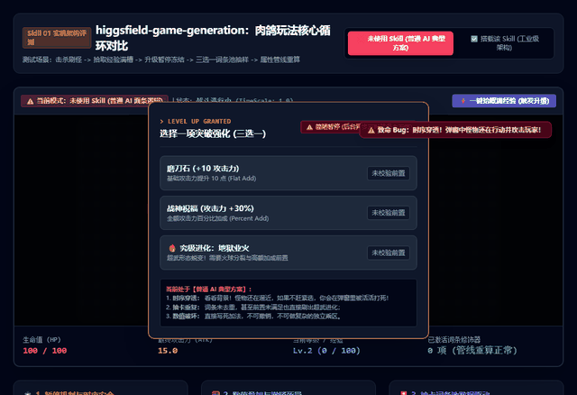
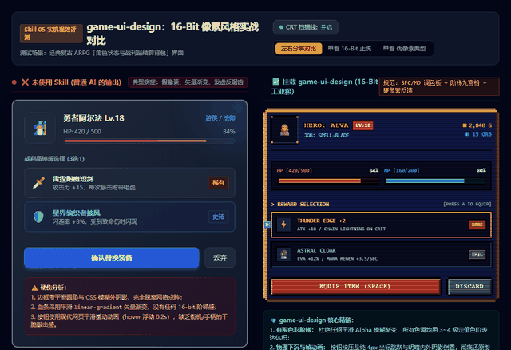
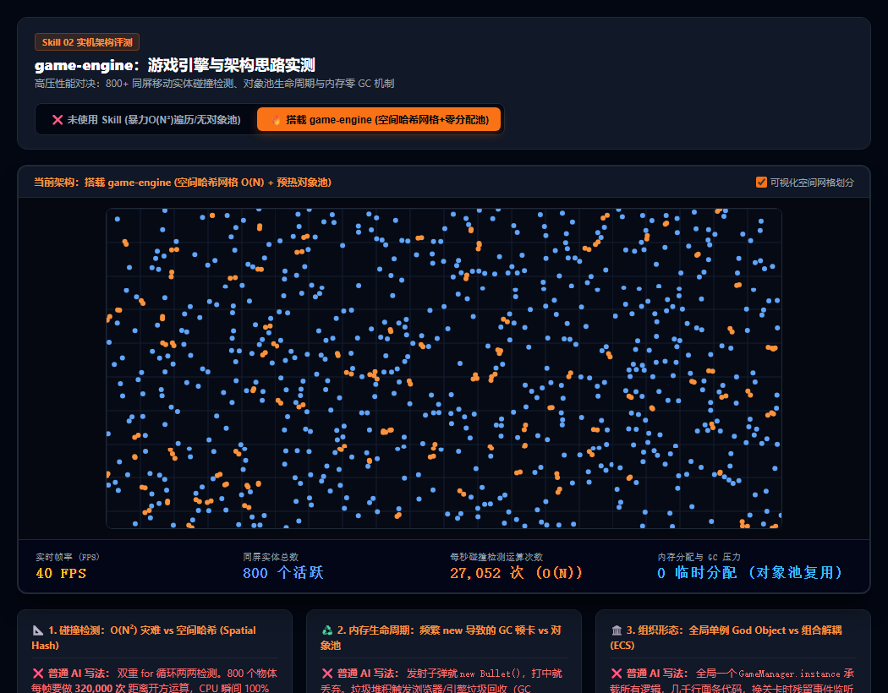
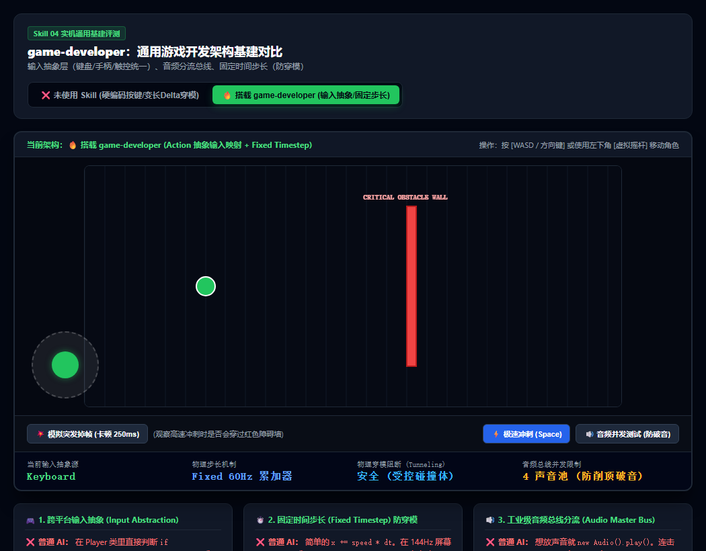
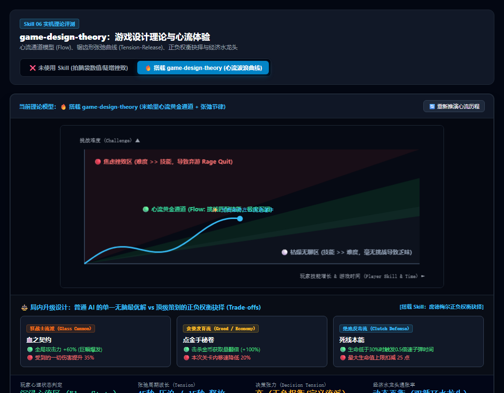
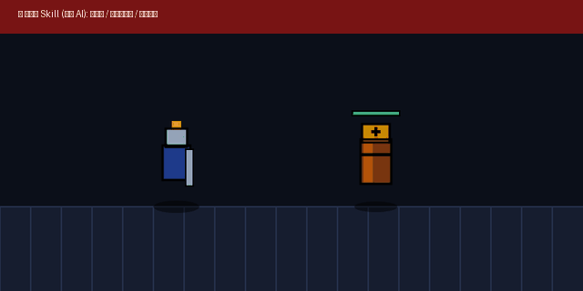
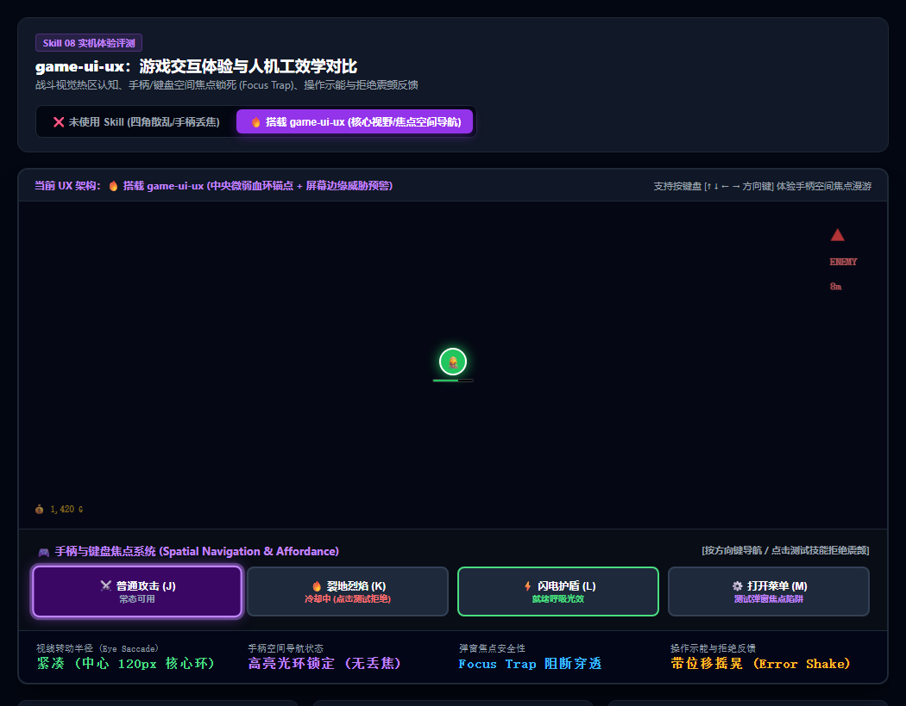
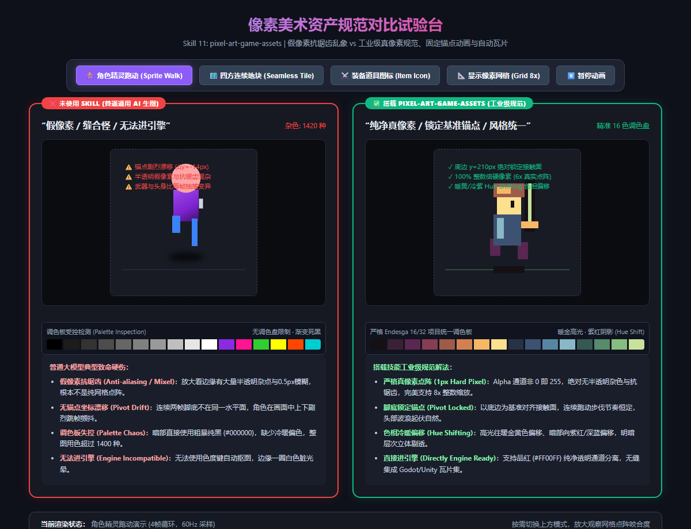
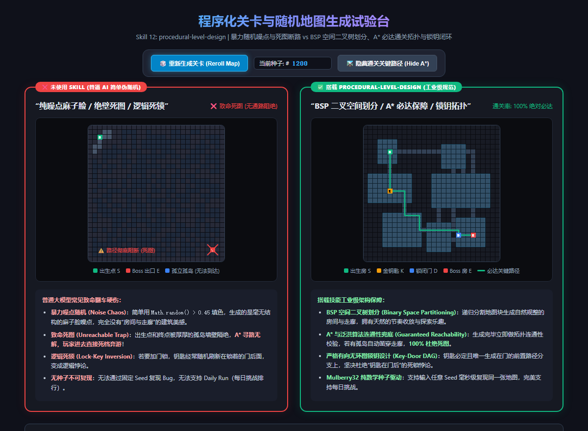
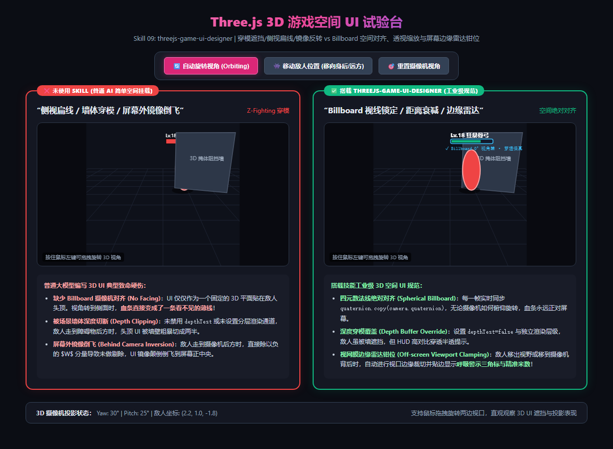

# 游戏制作技能库 (Game Skills) 🎮

> 面向独立游戏与小游戏开发者的 **AI 游戏开发专项 Skill 体系**。  
> 告别普通 AI 写的“塑料玩具代码”与“假像素缝合怪”，将工业级**游戏核心循环、正统 16-Bit 界面规范、真实物理打击感（Game Feel）**封装为可直接挂载的专家级 Agent Skills。

---

## 📸 实机对比与效果展示 (Visual Comparisons)

本项目所有 Skill 均经过严格的场景化实机测试，以下为挂载对应 Skill 与普通 AI 生成效果的残酷对比：

### 1. `higgsfield-game-generation`：肉鸽玩法核心循环实机动态对比



* **❌ 前半段（未使用 Skill - 普通 AI 典型方案）**：
  * **时序穿透（Pause Leak Bug）**：虽然写了 `isPaused = true`，但后台定时器未受控，玩家在弹窗选技能时被怪物围攻打死！
  * **词条硬编码与前置缺失**：三选一出现重复词条，甚至在没有主武器时直接刷出【超武进化】；
  * **数值破坏**：硬编码自增 `atk += 10`，无法叠加临时 Buff、百分比加成与撤销。
* **✅ 后半段（搭载 `higgsfield-game-generation` 工业级架构）**：
  * **时钟标尺绝对安全冻结**：引入严格的 **TimeScale = 0.0** 分层调度，怪物与投射物绝对锁死休眠，安全接收 UI 输入；
  * **数据驱动加权抽卡**：自动校验前置条件依赖（如拥有火球才可解锁分裂），无放回加权抽样绝对不重复；
  * **Modifier 属性四层管线**：Base -> Flat -> PercentAdd -> Multiplier，数值严密重算无副作用。
* 🎮 **在线直接试玩 (GitHub Pages)**：[点击在线体验肉鸽核心循环](https://orikami048.github.io/game-skills/prototypes/loop_showcase.html)  
  *(或本地点击：[http://localhost:8088/prototypes/loop_showcase.html](http://localhost:8088/prototypes/loop_showcase.html))*

#### 🌐 真实游戏业务落地场景与实战举例 (为什么能让游戏 Bug 锐减 90%？)

本 Skill 本质上是搭建了一套**“规则引擎（Rules Engine）”**，除肉鸽割草外，以下 6 大复杂业务场景均可直接应用：

| 业务场景 | 典型代表游戏 | 经典痛点举例 (普通 AI 翻车现场) | 本 Skill 工业级架构解法举例 |
|---|---|---|---|
| **1. 卡牌构筑与遗物联动** | 《杀戮尖塔》<br>《小丑牌》 | **痛点**：遗物 A“每出 3 张牌伤害翻倍”，遗物 B“濒死反弹伤害”。普通 AI 在每张牌函数里写死 `if-else`，时序颠倒，两个反弹被动相互触发导致**程序无限递归爆栈**。 | **解法**：分阶段事件钩子管线（`PreDamage -> OnDamage -> PostDamage`）。遗物作为独立监听器注册，同一 Phase 单帧内仅生效一次，杜绝连锁死锁。 |
| **2. 装备词缀与随机掉落** | 《暗黑破坏神》<br>《流放之路》 | **痛点**：装备带有 4~6 条随机前缀后缀（如“攻击 +50，攻速 +15%，血量低于 30% 独立增伤 80%”）。玩家洗词缀或脱装备时，普通 AI 用写死的自减，**导致加乘混合后数值算错、甚至攻击力永久被扣成负数**。 | **解法**：Modifier 四层属性管线：$$\text{Total} = (\text{Base} + \text{Flat}) \times (1 + \text{PercentAdd}) \times \text{Multiplier}$$ 穿装备挂载带 `sourceId` 的节点，脱装备一键注销，毫秒级无损重推，数值绝对干净。 |
| **3. 模拟经营与制造议价** | 《众神杂货铺》<br>《动物餐厅》 | **痛点**：**① 炼丹炼器**：火候控制（文火/武火）-> 成色结算 -> 爆丹或出极品；**② 神明议价谈判**：顾客进店 -> 探查需求 -> 玩家以次充好/抬价 -> 欺诈判定（欺诈值累加）-> 成功大赚或触怒神明遭天谴神罚。普通 AI 全局乱写布尔值，弹窗中途打断直接卡死。 | **解法**：建立严密的**有限状态机（FSM）**驱动阶段转移；议价成功率走多重加权判定公式（店铺声望 + 道具品级 - 神明神格），状态绝不死锁，支持离线挂机收益安全推导。 |
| **4. 自走棋阶段流转与羁绊** | 《云顶之弈》<br>《金铲铲》 | **痛点**：回合包含“准备倒计时 30s -> 传送进场 -> 自动索敌战斗 -> 胜负扣血”。且凑齐 3 个火系英雄全队加攻，凑齐 6 个召唤流星雨。普通 AI 阶段切换不干净，上一回合的临时 Buff 带到下一回合。 | **解法**：GameFlowManager 阶段受控流转，回合结束自动清空战斗临时态；Tag 扫描器每回合动态统计场上英雄，统一给全员注入或收回队伍全局 Modifier。 |
| **5. 幸存者/塔防 AI 导演刷怪** | 《暖雪》<br>《保卫萝卜》 | **痛点**：普通 AI 刷怪用 `setInterval(() => spawn(), 1000)`，玩家伤害不足清怪慢时，同屏堆积数千个碰撞体**导致游戏掉帧至个位数甚至崩溃**；或者难度断层突变瞬间暴毙。 | **解法**：引入 **AI 导演威胁预算（Threat Budget）**：根据玩家存活时间与清怪效率动态调配刷新点数（小怪扣 1 点，精英怪扣 15 点），同屏超出上限自动休眠远端实体，流畅不卡顿。 |
| **6. 网状技能树与洗点进阶** | 《流放之路》<br>《魔兽世界》 | **痛点**：点亮核心天赋 C 必须先点 A 和 B。玩家一旦洗点退掉中间的前置技能，普通 AI 无法校验后置依赖是否依然连通，**导致玩家卡出非法属性甚至逻辑死锁**。 | **解法**：基于**有向无环图（DAG）**建立连通性校验引擎。洗点退点时递归溯源后置连通性，自动级联卸载断开连接的全部属性修饰器。 |

---

### 2. `game-ui-design`：16-Bit 像素游戏 UI 实机动图演示



* **❌ 左侧（未使用 Skill - 普通 AI 常见作派）**：现代矢量平滑圆角、平滑渐变血条、CSS3 模糊投影、0.3s 缓动悬浮动画，呈现浓浓的“伪像素/现代网页缝合怪”违和感。
* **✅ 右侧（搭载 `game-ui-design` 工业级规范）**：
  * **SFC 经典双层金属边框**：纯代码多重阴影嵌套，严格 2px/4px 整数倍点阵咬合；
  * **阶梯像素血条**：3 级定值色阶表达体积，拒绝任何平滑渐变；
  * **街机微动手感**：0ms 渐变延迟，按压纯物理**下沉 4px**，高光与阴影瞬态反转；
  * **复古滤镜支持**：内置可选 CRT 显像管扫描线（Scanlines）光栅。
* 🎮 **在线直接试玩 (GitHub Pages)**：[点击在线体验 16-Bit UI 原型](https://orikami048.github.io/game-skills/prototypes/ui_showcase.html)  
  *(或本地点击：[http://localhost:8088/prototypes/ui_showcase.html](http://localhost:8088/prototypes/ui_showcase.html))*

---

### 3. `game-engine`：底层架构与 800+ 实体高压对决（静态架构参考）



* **❌ 未使用 Skill（暴力 O(N²) 与频繁 new）**：800 个实体双重循环两两检测碰撞，每帧执行 320,000 次距离开方运算，CPU 100% 满载，帧率跌至 12 FPS PPT 状态；高频 `new` 对象引发剧烈 GC 卡顿；
* **✅ 搭载 `game-engine`（工业级架构）**：
  * **空间哈希网格（Spatial Hash Grid）**：将世界切分为 40px 单元格，仅对同格及周边 8 格做局部检测，计算量骤降 95%，帧率稳定满帧 60 FPS；
  * **零分配对象池（Zero-allocation Pool）**：预热实体并复用，0 次运行时临时分配，内存曲线平滑如镜，根除 GC Spike 掉帧；
  * **组合优于继承（Composition）**：解耦全局单例 God Object，场景生命周期严格托管清理，杜绝跨关卡内存泄漏。
* 🎮 **在线直接试玩 (GitHub Pages)**：[点击在线体验 800 实体性能压测](https://orikami048.github.io/game-skills/prototypes/engine_showcase.html)  
  *(或本地点击：[http://localhost:8088/prototypes/engine_showcase.html](http://localhost:8088/prototypes/engine_showcase.html))*

---

### 4. `game-developer`：通用游戏开发工程基建与防穿模（静态架构参考）



* **❌ 未使用 Skill（变长 dt 物理与按键硬编码）**：高速冲刺或掉帧 200ms 时，单帧大位移导致**角色直接穿过障碍薄墙发生严重物理穿模（Tunneling Bug）**；玩家移动代码写死按键，换手机端虚拟摇杆或手柄改键必须推倒重构；
* **✅ 搭载 `game-developer`（工业级基建）**：
  * **半固定时间步长累加器（Fixed Timestep）**：物理恒定 60Hz 切分子步长迭代，任何高刷屏或严重掉帧下**绝对阻断穿模**；
  * **Action-based 输入抽象映射**：键盘、手柄摇杆与屏幕触控摇杆统一由适配器归一化派发，100% 跨平台代码零修改；
  * **音频总线声池**：三路分流（Master/BGM/SFX），并发限幅防爆音削顶破音。
* 🎮 **在线直接试玩 (GitHub Pages)**：[点击在线体验输入抽象与防穿模试验台](https://orikami048.github.io/game-skills/prototypes/developer_showcase.html)  
  *(或本地点击：[http://localhost:8088/prototypes/developer_showcase.html](http://localhost:8088/prototypes/developer_showcase.html))*

---

### 5. `game-design-theory`：游戏设计理论与心流体验模型（静态架构参考）



* **❌ 未使用 Skill（拍脑袋线性数值与单一最优解）**：难度直线飙升，前 60 秒平淡无聊，随后突然刺穿心流通道撞进红色【挫败弃游区】，玩家被秒杀愤怒弃游；升级选项存在闭眼必选的绝对最优解，策略深度归零；
* **✅ 搭载 `game-design-theory`（工业级策划理论）**：
  * **米哈里心流黄金通道（Flow Channel）**：难度呈**锯齿形波浪上升（Tension & Release）**，高压波次消耗资源制造心跳，宝箱与安全休整释放成就感，始终锁定心流通道；
  * **席德梅尔“有意义的抉择”（Meaningful Choices）**：选项绝无最优解，全部采用正负权衡（Trade-offs，如狂战士流高爆发但高易伤、贪婪流多金币但降移速），每个选择都在定义流派（Build）；
  * **水龙头与排水孔（Tap & Sink）**：双循环通胀拦截模型，货币长期保值，杜绝后期金币爆炸通胀。
* 🎮 **在线直接试玩 (GitHub Pages)**：[点击在线体验心流曲线与抉择试验台](https://orikami048.github.io/game-skills/prototypes/theory_showcase.html)  
  *(或本地点击：[http://localhost:8088/prototypes/theory_showcase.html](http://localhost:8088/prototypes/theory_showcase.html))*

---

### 6. `game-feel`：动作游戏打击感与微反馈实机动态对比（全循环动图）



* **❌ 前半段（未使用 Skill）**：只有简单的伤害数字匀速直飘与粗暴扣血，无阻力、无顿挫，轻飘飘软绵绵如切薄纸。
* **✅ 后半段（搭载 `game-feel` 工业级神经生理欺骗系统）**：
  * **顿帧定格（Hitstop: 75ms）**：命中瞬间全局时空冻结 4~5 帧，赋予兵刃切入骨肉的硬核物理阻力；
  * **受击纯白闪烁（White Flash）**：首帧纯白高亮 2 帧，极强视网膜刺激；
  * **创伤衰减震屏（Trauma² Shake）**：基于 Vlambeer 公式，微击微颤、重击剧烈，带角位移微偏转；
  * **弹性挤压拉伸（Squash & Stretch）**：受击瞬间横向拉宽 **1.45 倍**、纵向压扁，呈现肉质弹性受力；
  * **切向爆裂火花**：沿挥砍法线锥形喷涌 28 颗高初速重力火花；
  * **声学协同**：纯数学合成低频钝击沉闷重音（Impact Thud）与破裂噪音。
* 🎮 **在线直接试玩 (GitHub Pages)**：[点击在线体验打击感 60FPS 战斗试验台](https://orikami048.github.io/game-skills/prototypes/feel_showcase.html)  
  *(或本地点击：[http://localhost:8088/prototypes/feel_showcase.html](http://localhost:8088/prototypes/feel_showcase.html))*

---

### 7. `game-ui-ux`：游戏人机工效学、战斗 HUD 视觉热区与手柄空间焦点（静态架构参考）



* **❌ 未使用 Skill（四角堆砌 / 视线拉扯 / 手柄丢焦穿透）**：
  * **视野隧道现象（Tunnel Vision）**：血条死死锁在左上角、小地图在右上角、技能在右下角，打怪走位时眼球在 800px 广阔屏幕间疲劳拉扯，玩家经常“根本不知道自己怎么暴毙的”；
  * **手柄丢焦与输入穿透（Focus Leak）**：二级弹窗（确认/暂停）弹出后，手柄确认键直接穿透背景触发了角色挥刀或大招释放；且无法使用十字键顺畅导航按钮。
* **✅ 搭载 `game-ui-ux`（工业级主机人机工效标准）**：
  * **核心视野环（Inner Anchor）**：角色脚底微弧形动态血量与耐力指示，视线 0 位移；屏幕外高威胁敌人投影边缘雷达三角标（Off-screen Indicators），提供充裕闪避反应时间；
  * **空间几何焦点导航（Spatial Navigation）**：支持手柄十字键/键盘 Tab 沿视线方向寻找最近邻居按钮，自适应高亮焦点光环；
  * **绝对焦点陷阱（Focus Trap）**：模态弹窗唤起瞬间强制捕获全部输入流，物理切断底层世界响应，关闭后毫秒级光标记忆复位；
  * **操作示能与拒绝摇晃（Error Shake）**：CD 冷却中点击触发 0.35s 真实物理横向摇晃与拒绝音效，就绪瞬间呼吸扫光，消除玩家“游戏是不是卡死”的焦虑。
* 🎮 **在线直接试玩 (GitHub Pages)**：[点击在线体验 UI/UX 人机工效与手柄焦点试验台](https://orikami048.github.io/game-skills/prototypes/ui_ux_showcase.html)  
  *(或本地点击：[http://localhost:8088/prototypes/ui_ux_showcase.html](http://localhost:8088/prototypes/ui_ux_showcase.html))*

---

### 8. `pixel-art-game-assets`：像素美术资产规范、真点阵与自动瓦片（静态架构参考）



* **❌ 未使用 Skill（假像素抗锯齿 / 锚点漂移 / 接缝断裂）**：
  * **假像素与 Mixel 诅咒**：通用模型输出连续潜空间图像，边缘充斥半透明杂点与 0.5px 模糊，不同元素像素块大小严重失调，整图用色超过 1400 种杂色，无法干净分离 Alpha 通道进引擎；
  * **动画锚点跳跃（Pivot Drift）**：生成连续帧时双脚不在同一基准线，跑动动画上下晃动 10px 呈现抽搐状态；
  * **四方地块接缝撕裂**：平铺九宫格地块边缘断层明显，无法生成 47-Blob 自动过渡瓦片。
* **✅ 搭载 `pixel-art-game-assets`（工业级像素资产标准）**：
  * **100% 纯净硬点阵 (1px Hard Pixel)**：Alpha 通道非 0 即 255，绝对无半透明羽化与抗锯齿，完美支持 8x 整数倍点阵咬合与品红 (`#FF00FF`) 纯净抠图；
  * **底边锁定锚点 (Pivot Locked)**：脚底接触面死锁在基准像素行，连续奔跑与攻击帧循环平稳自然；
  * **冷暖色阶偏移 (Hue Shifting)**：高光偏金色暖黄、阴影偏冷暗紫红，摆脱粗暴死黑脏灰色，质感璀璨；
  * **无缝自动平铺 (Seamless 47-Blob Autotile)**：边缘像素 100% 互补衔接，匹配 RPGMaker 与 Tiled 瓦片集规范。
* 🎮 **在线直接试玩 (GitHub Pages)**：[点击在线体验像素美术资产与自动瓦片试验台](https://orikami048.github.io/game-skills/prototypes/pixel_assets_showcase.html)  
  *(或本地点击：[http://localhost:8088/prototypes/pixel_assets_showcase.html](http://localhost:8088/prototypes/pixel_assets_showcase.html))*

---

### 9. `procedural-level-design`：程序化关卡、BSP 地牢划分与 A* 必达通关拓扑（静态架构参考）



* **❌ 未使用 Skill（纯噪点麻子脸 / 绝壁死图 / 逻辑死锁）**：
  * **毫无结构的麻子脸**：直接用 `Math.random() > 0.45` 随机撒点，没有主次动线，没有房间与走廊之分；
  * **致命死图阻绝 (Unreachable)**：出生点 S 到 Boss 房 E 被死死封死，A* 寻路无解，通关率为 0%，玩家被迫强退死档；
  * **钥匙在门后悖论**：缺少图论拓扑因果约束，钥匙被随机刷在锁着的门后，产生逻辑死锁；
  * **无种子不可复现**：每次运行完全玄学随机，线上恶性地形 Bug 根本无法通过 Seed 还原。
* **✅ 搭载 `procedural-level-design`（工业级 PCG 关卡管线）**：
  * **BSP 二叉空间树划分 (Binary Space Partitioning)**：大块空间递归切割，自动生成主厅、辅房与回廊，节奏张弛有度；
  * **A* 与泛洪算法连通性兜底 (Guaranteed Reachability)**：关卡生成后自动做拓扑连通性校验，若有孤岛自动凿穿走廊，**100% 杜绝死图**；
  * **严格有向无环图锁钥拓扑 (Key-Lock DAG)**：钥匙必定且唯一生成在门的前置分支上，坚决杜绝“钥匙在门后”的死锁悖论；
  * **Mulberry32 纯数学种子驱动**：同一串 Seed（如 `#SEED-4829`）在任意平台毫秒级复现绝对一致的地图，完美支持每日挑战天梯榜（Daily Run）。
* 🎮 **在线直接试玩 (GitHub Pages)**：[点击在线体验程序化关卡与随机地图试验台](https://orikami048.github.io/game-skills/prototypes/level_showcase.html)  
  *(或本地点击：[http://localhost:8088/prototypes/level_showcase.html](http://localhost:8088/prototypes/level_showcase.html))*

---

### 10. `threejs-game-ui-designer`：Three.js 3D 游戏空间 UI、Billboard 视线锁定与屏幕外雷达（静态架构参考）



* **❌ 未使用 Skill（简单挂载 / 侧视扁线 / 深度穿模）**：
  * **侧视视角失真**：UI 仅为一个固定 3D 平面，侧面看时直接失真压缩成一条看不见的薄线；
  * **墙体深度粗暴截断**：未设置 `depthTest=false` 或独立渲染层级，掩体高墙将血条拦腰切断；
  * **屏幕外镜像反转**：敌人跑到背后时，UI 镜像倒飞在屏幕前乱跳；同屏 100 个 DOM 节点引发重排卡顿。
* **✅ 搭载 `threejs-game-ui-designer`（工业级规范）**：
  * **四元数空间公告板 (Spherical Billboard)**：每帧实时同步 `quaternion.copy(camera.quaternion)`，无论视角如何旋转，血条始终 100% 正对玩家屏幕；
  * **深度穿透覆盖 (Depth Buffer Override)**：开启深度覆写与高对比外发光，即使敌人躲在掩体背后，血条与轮廓依然清晰半透可辨；
  * **视网膜边缘雷达钳位 (Off-screen Viewport Clamping)**：敌人移出视野或移到镜头背后时，自动进行视口边缘裁切并贴边显示**呼吸警示三角标与精准米数**！
* 🎮 **在线直接试玩 (GitHub Pages)**：[点击在线体验 Three.js 3D 空间 UI 试验台](https://orikami048.github.io/game-skills/prototypes/threejs_ui_showcase.html)  
  *(或本地点击：[http://localhost:8088/prototypes/threejs_ui_showcase.html](http://localhost:8088/prototypes/threejs_ui_showcase.html))*

---

## 🤖 适配与实测推荐模型矩阵 (Model Matrix)

为确保 Skills 发挥最佳效果，针对不同开发环节推荐选用最匹配的模型：

| 开发任务环节 | 推荐使用模型 | 实测表现与推荐原因 |
|---|---|---|
| **代码实现与手感逻辑** | **Gemini 3.8 Flash (High)**<br>*(实操验证推荐)* | 响应迅速，逻辑严密。能准确理解 60FPS 游戏循环中的顿帧挂起、阻尼摩擦力数学公式与 0ms 像素位移。 |
| **高复杂度底层系统与网络** | **Claude 3.7 Sonnet** / **Gemini 3.8 Pro** | 适合生成复杂的 Modifier 属性管线、Godot/Unity HLSL 像素着色器以及多人帧同步/预测回滚逻辑。 |
| **3D 空间 UI 与公告板数学** | **Claude 3.7 Sonnet** / **Gemini 3.8 Flash** | 空间四元数姿态同步、视口椭圆安全区钳位与背面点积翻转极度精确。 |
| **像素资产出图 (Sprite/UI)** | **Imagen 3 (Fast / HQ)** / **Gemini 3.8 Flash ImageGen** | 对 `#FF00FF` 品红底与“无外发光、无抗锯齿”负面提示词执行力强，网格漂移率极低。 |
| **程序化关卡与图论拓扑** | **Claude 3.7 Sonnet** / **Gemini 3.8 Flash** | 空间二叉树切分紧凑，极擅长 A* 泛洪校验、锁钥 DAG 依赖与 Mulberry32 位运算。 |
| **手柄导航与人机工效设计** | **Claude 3.7 Sonnet** / **Gemini 3.8 Flash** | 空间几何射线检测推导强，极度熟悉 Focus Trap 焦点栈防穿透与 Nielsen 人机工效学。 |
| **风格锚点与概念原画** | **Midjourney v6 (`--style raw`)** | 适合立项初期确立复古调色盘与全局艺术基调。 |

---

## 📂 项目结构

```text
game-skills/
├── README.md                      # 项目简介（实机对比、模型推荐与试玩导航）
├── assets/                        # 高清对比截图
│   ├── ui_comparison.png          # 16-Bit UI 左右分屏实机对比
│   ├── feel_comparison.png        # Game Feel 高能打击感命中实机图
│   ├── ui_ux_comparison.png       # UI/UX 人机工效与手柄焦点架构图
│   ├── pixel_assets_comparison.png# 像素资产真假对比与瓦片架构图
│   ├── level_comparison.png       # 程序化关卡与拓扑必达路径图
│   └── threejs_ui_comparison.png  # Three.js 3D 空间 UI 与 Billboard 架构图
├── prototypes/                    # 独立交互试玩原型 (可直接在浏览器中打开试玩)
│   ├── loop_showcase.html         # 肉鸽核心循环试验台 (零依赖/时空冻结/抽卡)
│   ├── engine_showcase.html       # 引擎底层架构试验台 (800实体压测/空间哈希/对象池)
│   ├── developer_showcase.html    # 通用开发基建试验台 (跨端输入抽象/固定步长防穿模)
│   ├── theory_showcase.html       # 策划理论心流试验台 (心流黄金通道/正负权衡抉择)
│   ├── ui_showcase.html           # 16-Bit UI 交互原型 (SFC 边框/4px下沉/扫描线)
│   ├── feel_showcase.html         # 60FPS 战斗打击面试验台 (带音效与参数开关)
│   ├── ui_ux_showcase.html        # UI/UX 人机工效与焦点陷阱试验台
│   ├── pixel_assets_showcase.html # 像素点阵与无缝自动瓦片试验台
│   ├── level_showcase.html        # 程序化关卡与拓扑必达路径试验台
│   └── threejs_ui_showcase.html   # Three.js 3D 空间 UI 与边缘雷达试验台
└── skills/                        # 核心技能正本
    ├── higgsfield-game-generation/# 核心玩法生成、状态机闭环与 Modifier 属性管线
    │   ├── SKILL.md
    │   └── comparison.png
    ├── game-engine/               # 游戏引擎架构、空间哈希网格与对象池
    │   ├── SKILL.md
    │   └── comparison.png
    ├── game-developer/            # 通用游戏开发基建、输入抽象与固定步长防穿模
    │   ├── SKILL.md
    │   └── comparison.png
    ├── game-design-theory/        # 游戏设计理论、心流通道模型与有意义的抉择
    │   ├── SKILL.md
    │   └── comparison.png
    ├── game-ui-design/            # 16-Bit 游戏 UI 规范与九宫格边框
    │   ├── SKILL.md
    │   └── comparison.gif
    ├── game-feel/                 # 游戏手感、顿帧、震屏与受击反馈算法
    │   ├── SKILL.md
    │   └── comparison.gif
    ├── game-ui-ux/                # 游戏 UI/UX 交互人机工效与手柄空间焦点
    │   ├── SKILL.md
    │   └── comparison.png
    ├── pixel-art-game-assets/     # 像素游戏美术资产规范、真点阵与自动瓦片
    │   ├── SKILL.md
    │   └── comparison.png
    ├── procedural-level-design/   # 程序化关卡、BSP 二叉树与 A* 必达通关拓扑
    │   ├── SKILL.md
    │   └── comparison.png
    └── threejs-game-ui-designer/  # Three.js 3D 空间 UI、Billboard 与屏幕边缘雷达
        ├── SKILL.md
        └── comparison.png
```
```

---

## 🚀 安装与挂载

### 1. Google Antigravity (Gemini)
复制技能目录到全局配置即可自动热加载：

```powershell
Copy-Item -Recurse -Force skills\* $env:USERPROFILE\.gemini\config\skills\
```

### 2. Claude Code
复制技能目录到用户级 skills 目录：

```powershell
Copy-Item -Recurse -Force skills\* $env:USERPROFILE\.claude\skills\
```

---

## 📜 许可证
MIT License. 欢迎独立游戏开发者与小游戏创作者自由使用与扩展！
