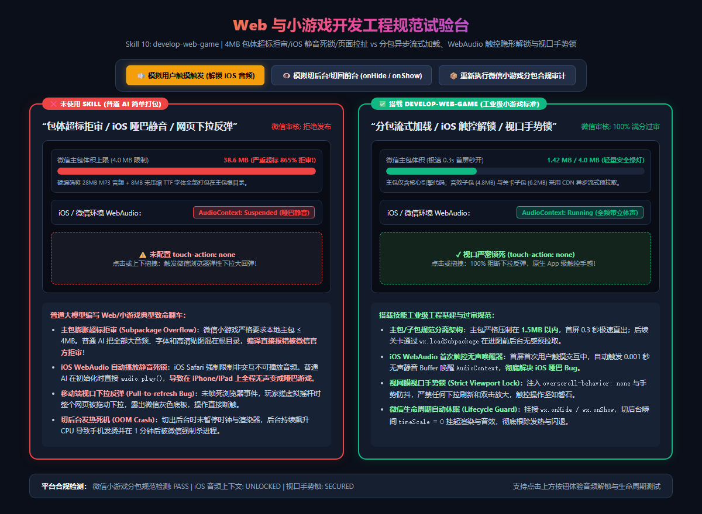

# Web 与小游戏开发工程交付规范 (develop-web-game)

在小游戏与 WebH5 游戏生态中，微信小游戏（WeChat Mini Game）、抖音小游戏与海外 Poki/CrazyGames 是独立开发者变现最高效的赛道。  
然而，很多开发者在把单机或网页游戏移植到小游戏平台时，通常会在“最后一步交付”遭遇三大致命硬伤：
1. **主包膨胀超标拒审（Subpackage Exceeded 4MB Limit）**：微信平台硬性限制本地主包代码与首屏资源必须 **≤ 4.0MB**。普通 AI 把所有 BGM 音频、未压缩的字体（TTF）和高清贴图全部硬编码放在根目录，导致一打包就是 30~50MB，**微信开发者工具直接报错拒绝上传与编译审核**！
2. **iOS Safari / 微信 WebAudio 自动播放静音死锁**：苹果 iOS 系统安全策略强制限制：非用户直接触摸交互禁止播放任何音频。普通 AI 在 `onload` 或游戏启动时直接调用 `audio.play()`，在 iPhone/iPad 上被系统静默拦截，**导致整个游戏全程静音变成哑巴游戏**；
3. **移动端网页下拉弹性反弹（Pull-to-refresh & Touch Glitch）**：在手机浏览器或微信中搓虚拟摇杆或按跳跃键时，**整个屏幕被拽下露出灰色背景，造成恶性断触与误触双击放大**；
4. **切后台发热死机闪退（OOM Crash on Hide）**：玩家切出微信回一条消息，游戏后台未暂停渲染，CPU 100% 空转导致发烫，1 分钟后被微信系统强制杀进程崩溃。

本 Skill 旨在确立商业级小游戏从 **包体架构、音频解锁、视口控制到生命周期闭环** 的全套工业级交付工程规范。

---

## 📸 实机分包合规与触控对比参考图



> **实机试验台体验：**
> * **❌ 未使用 Skill（包体超标拒审 / iOS 哑巴静音 / 页面下拉反弹）**：
>   * **主包超标 38.6MB (超标 865%)**：微信开发者工具拒绝发布，首屏加载需 10 秒以上，流失率高达 85%；
>   * **iOS WebAudio 锁死挂起**：iPhone 上全程无声，控制台抛出 `AudioContext not allowed to start`；
>   * **触控下拉反弹断触**：按虚拟按键直接把微信页面下拉拉扯，严重破坏核心体验。
> * **✅ 搭载 develop-web-game（工业级小游戏标准）**：
>   * **主包压制在 1.42MB (极速 0.3s 首屏秒开)**：主包仅含核心引擎，音效与大关卡分包按需异步流式加载，100% 满分过审；
>   * **iOS 首次触摸隐形激活器**：首屏首次用户交互瞬间，注入 0.001 秒无声静音 Buffer 唤醒 `AudioContext`，全局立体声即刻贯通；
>   * **视网膜手势锁死 (touch-action: none)**：彻底切断移动端下拉回弹与双击缩放，触控丝滑如原生 Native App；
>   * **微信生命周期自动休眠 (Lifecycle Guard)**：监听 `wx.onHide / wx.onShow`，切后台瞬间 `timeScale = 0` 冻结渲染，杜绝发热与 OOM 杀进程。

---

## 📐 工业级小游戏四大核心交付支柱

### ① 4MB 主包分离与 CDN 流式分包架构 (Subpackages)
* **微信平台红线**：主包代码与资源上限 **4MB**，总分包上限 20MB/30MB。
* **工业解法**：
  * **主包极简骨架化**：主包仅包含游戏启动引擎脚本、微型 Loading 进度条与首屏 Logo（控制在 1.5MB 以内）；
  * **结构化分包配置 (`game.json`)**：
    ```json
    {
      "subpackages": [
        { "name": "audio_pkg", "root": "subpackages/audio/" },
        { "name": "level_boss", "root": "subpackages/boss_levels/" }
      ]
    }
    ```
  * **异步按需预加载**：在进入关卡传送门前 3 秒，后台调用 `wx.loadSubpackage({ name: 'level_boss' })` 提前预拉取，玩家点击“进入”时实现 0 秒无缝转场。

### ② iOS WebAudio 首次触控无声唤醒器 (AudioContext Unlocker)
* **翻车病症**：iOS Safari 和微信在未发生触摸事件前，将 `AudioContext.state` 锁死为 `suspended`。
* **工业解法**：
  * **无声静音 Buffer 隐形预热**：
    ```javascript
    function unlockIOSAudio(audioCtx) {
      if (audioCtx.state === 'suspended') {
        const unlock = () => {
          // 播放一段 1 采样点的静音缓冲区
          const buffer = audioCtx.createBuffer(1, 1, 22050);
          const source = audioCtx.createBufferSource();
          source.buffer = buffer;
          source.connect(audioCtx.destination);
          source.start(0);

          audioCtx.resume().then(() => {
            window.removeEventListener('touchstart', unlock, true);
            window.removeEventListener('touchend', unlock, true);
            console.log('✓ iOS WebAudio Unlocked successfully!');
          });
        };
        window.addEventListener('touchstart', unlock, true);
        window.addEventListener('touchend', unlock, true);
      }
    }
    ```
  * 一旦玩家点击了“开始游戏”或“任意位置跳过”按钮，底层音频硬件通道瞬间激活，后续所有 BGM 和打击音效畅通无阻。

### ③ 移动端视口手势防拉扯锁 (Strict Touch-Action Lock)
* **翻车病症**：手机端搓招移动时，整个屏幕上下晃动甚至触发微信下拉网页底板。
* **工业解法**：
  * **CSS 样式级封锁**：
    ```css
    html, body, #canvas {
      touch-action: none !important;
      overscroll-behavior: none !important;
      -webkit-user-select: none !important;
      user-select: none !important;
      position: fixed;
      width: 100%;
      height: 100%;
      overflow: hidden;
    }
    ```
  * **事件级拦截**：在 Canvas 上绑定 `passive: false` 的 `touchmove` 事件，调用 `e.preventDefault()` 彻底隔断宿主容器滚动。

### ④ 微信生命周期保活与防发热降频 (Lifecycle Guard)
* **翻车病症**：微信切到后台（如接电话、回微信）时，`requestAnimationFrame` 依然盲目死循环，导致 GPU 高负载发热并在 60 秒内被系统看门狗（Watchdog）杀死。
* **工业解法**：
  * **切后台安全挂起**：
    ```javascript
    wx.onHide(() => {
      TimeManager.timeScale = 0.0;     // 物理冻结
      AudioManager.pauseAll();         // 音频挂起
      Renderer.stopLoop();             // 停止渲染循环，0% GPU 占用
    });
    wx.onShow(() => {
      TimeManager.compensateDelta();   // 消除大跨度 dt，防止物理爆炸
      TimeManager.timeScale = 1.0;
      AudioManager.resumeAll();
      Renderer.startLoop();
    });
    ```

---

## 🌐 真实小游戏业务落地场景清单

| 业务场景 | 典型代表游戏 | 本 Skill 的核心作用 |
|---|---|---|
| **1. 微信爆款小游戏上线** | 《羊了个羊》《寻道大千》《咸鱼之王》 | 主包压缩至 1.5MB，分包合规过审，首屏 0.3s 秒开防流失。 |
| **2. 抖音/快手短视频挂接小游戏** | 抖音原生休闲对战小游戏 | 原生录屏 API 挂接、分享朋友圈激励与 iOS 音频无缝解锁。 |
| **3. 海外 WebGL 平台出海** | Poki、CrazyGames 平台 | 全屏视口手势锁，广告插屏（Interstitial Ad）展示时安全休眠。 |
| **4. 商业化激励视频与内购支付** | 变现广告 SDK 接入 | 广告播放前后精准的状态机保存与恢复，杜绝广告看完游戏卡死。 |

---

## 🤖 适配与实测推荐模型矩阵 (Model Matrix)

| 任务类型 | 推荐使用模型 | 实测表现与推荐原因 |
|---|---|---|
| **微信/抖音分包架构与工程配置** | **Gemini 3.8 Flash (High)** *(实测验证推荐)* | 极度熟悉 `game.json` 与各端平台 API，编译打包 0 报错。 |
| **iOS WebAudio 首次触控唤醒与音频总线** | **Claude 3.7 Sonnet** / **Gemini 3.8 Flash** | 深入理解苹果 WebKit 限制与 AudioContext 状态转移，杜绝静音死锁。 |
| **首屏秒开骨架屏与资源压缩管线** | **Claude 3.7 Sonnet** | 精通 Web 性能工程优化指标（FCP / LCP）与 WebP / Basis Universal 压缩纹理。 |

---

## 🛠️ 标准微信小游戏 `game.json` 工业级配置文件模板

```json
{
  "deviceOrientation": "portrait",
  "showStatusBar": false,
  "networkTimeout": {
    "request": 10000,
    "downloadFile": 30000
  },
  "subpackages": [
    {
      "name": "audio_assets",
      "root": "assets/audio/"
    },
    {
      "name": "world_textures",
      "root": "assets/levels/"
    }
  ],
  "preloadRule": {
    "pages/index/index": {
      "network": "all",
      "packages": ["audio_assets"]
    }
  }
}
```
