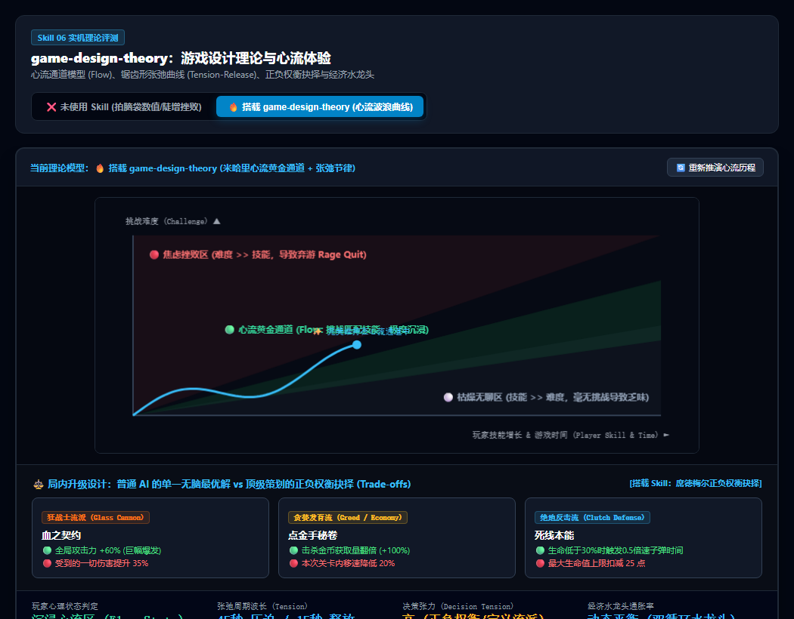

# 游戏设计理论与心流体验调优规范 (game-design-theory)

很多小游戏由普通 AI 快速生成代码后，玩起来却**“不好玩、很坐牢、或者 3 分钟就腻了”**。  
这不是代码语法的问题，而是**底层游戏设计理论（Game Design Theory）的全面崩塌**：
- 难度要么直线飙升瞬间劝退玩家，要么平铺直叙毫无波澜；
- 升级三选一经常存在闭眼必选的“绝对最优解”，策略深度归零；
- 掉落的金币几分钟后暴涨成天文数字，商店被搬空，经济系统彻底崩溃。

本 Skill 旨在确立现代顶级游戏策划的理论架构，从心理学和运筹学底层保障游戏的**长线留存、心流沉浸与策略张力**。

---

## 📸 实机心流模型与决策张力测试参考图

> **实机推演：**
> * **❌ 未使用 Skill（拍脑袋线性难度）**：难度呈指数级直线上升，前 60 秒平淡无聊，随后突然刺穿心流通道撞进红色【挫败弃游区】，玩家被秒杀愤怒弃游；升级选项存在闭眼无脑最优解；
> * **✅ 搭载 game-design-theory（工业级策划理论）**：
>   * **锯齿形波浪上升曲线（Tension & Release）**：高压紧张波次（消耗资源制造心跳）-> 宝箱奖励与割草休整（释放成就感），始终将玩家锁定在绿色【心流黄金通道】；
>   * **席德梅尔“有意义的抉择”（Meaningful Choices）**：选项绝无最优解，全部带有正负权衡（Trade-offs），每一次选择都在定义流派（Build）。

---

## 🎯 游戏策划三大支柱理论与防崩指南

### ① 米哈里心流理论 (Flow Theory) 与锯齿形张弛节律
* **翻车病症**：普通 AI 习惯把难度写成 `difficulty = time * 0.5`（线性增长）。
  * 玩家技能成长是一阶一阶跳跃式的，而线性增长的难度会导致难度很快远超玩家技能，直接击碎心智，产生强烈的**挫败弃游感（Rage Quit）**；
  * 如果难度给得过低，技能远超挑战，玩家立刻陷入**枯燥无聊（Boredom）**。
* **理论解法**：遵循 **锯齿形张弛曲线（Sawtooth Tension-Release Cycle）**：
  * **紧张阶段（Tension Phase, 30~45s）**：怪物波次压迫增强、移速加快，迫使玩家走位与交出大招底牌；
  * **释放阶段（Release Phase, 10~15s）**：击杀精英怪爆出满地金币与宝箱，清怪畅快割草，音乐由急促转为舒缓；
  * **技能跃迁（Skill Leap）**：通过拾取战利品强化属性，进入下一个更高的张弛循环，心智轨迹始终平稳在绿色黄金通道内。

### ② 席德梅尔“有意义的抉择” (Meaningful Choices / Trade-offs)
* **翻车病症**：设计出带有绝对数值优势的选项（如选项 A 攻击+25，选项 B 攻击+5）。
  * 任何智商正常的玩家都会闭眼选 A，导致选择失去了意义；
  * 玩家迅速摸索出单一的最优解套路，游戏重玩价值断崖式下跌。
* **理论解法**：必须制造 **不可替代的正负权衡（Dilemmas & Trade-offs）**：
  * **狂战士权衡（Glass Cannon）**：“全局攻击力 +60%，但受到的一切伤害提升 35%”；
  * **贪婪发育权衡（Greed Economy）**：“金币获取量翻倍，但本关卡内移速降低 20%”；
  * **绝地死线权衡（Clutch Defense）**：“生命低于 30% 触发 0.5 倍速子弹时间，但最大生命值上限扣减 25 点”；
  * 没有任何一项是纯收益，**每一次选择都是玩家对自身风险偏好与流派的赌注**。

### ③ 水龙头与排水孔模型 (Tap & Sink) 根除数值恶性通胀
* **翻车病症**：只设计了产出金币的水龙头（Tap），没有设计合理的消费排水孔（Sink）。游戏运行 10 分钟后金币通胀爆炸，玩家手握几十万金币无处花，核心驱动力瞬间蒸发。
* **理论解法**：建立 **双循环通胀拦截模型**：
  * **对数产出（Diminishing Taps）**：基础收益随波次呈对数（Logarithmic）平缓上升，拒绝指数暴增；
  * **边际效用递减（Diminishing Returns）**：相同属性每升一级，所需货币呈指数增长；
  * **消耗型排水孔（Deep Sinks）**：设计局内词缀重铸洗练、耐久修理、买活门槛；
  * **利息门槛机制（Interest Threshold，如《云顶之弈》）**：每保留 10 块钱下回合多给 1 块利息（上限 50 块），促使玩家在“当下保命消费”与“长线理财贪利息”之间持续纠结。

---

## 🌐 核心应用场景清单

| 业务场景 | 典型代表作品 | 本 Skill 的核心作用 |
|---|---|---|
| **1. 肉鸽与幸存者难度波次** | 《吸血鬼幸存者》《哈迪斯》 | 编排高低起伏的张弛波次（每 3 分钟一次精英压迫与释放），绝不让玩家产生死线疲劳。 |
| **2. 卡牌与策略流派构筑** | 《杀戮尖塔》《小丑牌》 | 确保遗物和卡牌不存在全能无敌解，强化 Build 间的相生相克与风险自负。 |
| **3. 放置与模拟经营数值** | 《众神杂货铺》《动物餐厅》 | 水龙头与排水孔动态配平，保证离线挂机收益合理，游戏玩一个月数值依然健康不崩。 |
| **4. 商业化与挫败感兜底 (Pity/Safety Net)** | 抽卡、重度挑战关卡 | 引入保底机制（Bad Luck Protection）与动态难度下调（连续死亡 3 次时微弱削弱敌人攻击力）。 |

---

## 🤖 适配与实测推荐模型 (Model Recommendations)

| 任务类型 | 推荐使用模型 | 实测表现与推荐原因 |
|---|---|---|
| **心流曲线推演与张弛节律设计** | **Gemini 3.8 Flash (High)** *(实测验证推荐)* | 逻辑与心理学敏感度高，能快速生成符合心流通道的波浪数学公式与波次时间表。 |
| **重度数值平衡与经济大表测算** | **Claude 3.7 Sonnet** / **Gemini 3.8 Pro** | 极度擅长复杂的代数建模与边际效用分析，能构建百万级金币循环与通胀收敛大表。 |
| **机制与美学体验逆向推导 (MDA)** | **Claude 3.7 Sonnet** | 具备深刻的游戏叙事与美学洞察，擅长从“玩家情感体验”倒推最巧妙的规则机制。 |
