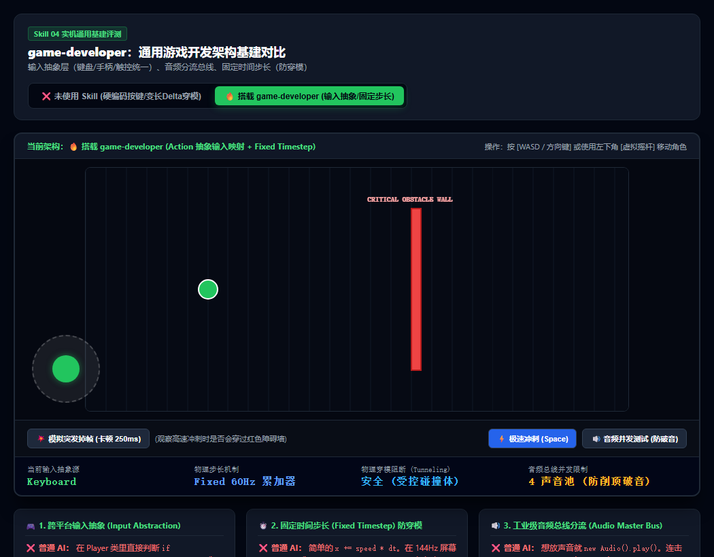

# 通用游戏开发架构与工程基建规范 (game-developer)

很多独立游戏在开发初期“只为了在电脑键盘上跑起来”，所有输入硬编码 `if (Input.is_pressed("W"))`，物理位移写死 `x += vx * dt`，播放声音随手 `new Audio()`。  
等游戏做到中后期想**移植到手机触屏（加虚拟摇杆）、支持手柄改键、优化掉帧穿墙、控制背景音量**时，发现底层架构全部耦合死锁，只能推倒重来。

本 Skill 旨在确立现代游戏工程的 **三大通用基建标准**：跨端输入抽象、固定时间步长防穿模、与工业级音频总线。

---

## 📸 实机基建架构与防穿模测试参考图



> **实机压测：**
> * **❌ 未使用 Skill（变长 dt 物理）**：在高速冲刺（Dash）或设备突发卡顿掉帧 200ms 时，单帧位移量超过墙体厚度，**角色直接瞬移穿过红色障碍墙，发生严重的物理穿模（Tunneling Bug）**；
> * **✅ 搭载 game-developer（工业级基建）**：
>   * **Fixed Timestep 累加器**：将时间严格切分为 60Hz 恒定物理子步长，即使掉帧也逐步迭代检测，**永不穿模**；
>   * **Input 抽象映射层**：键盘 WASD 与屏幕触控虚拟摇杆自动归一化融合，一套业务代码无缝通吃 PC/触屏/手柄；
>   * **音频总线声池**：并发限制防爆音，独立调节 Master/BGM/SFX。

---

## 🎯 通用游戏开发三大致命痛点与工业级解法

### ① 跨平台输入抽象 (Input Action Mapping)
* **翻车病症**：玩家移动代码里写死了 `if (keys['KeyW'])`。当想要发布到微信小游戏/手机端加触屏虚拟摇杆，或者支持 Xbox 手柄改键时，必须把整个人物控制逻辑拆掉重构。
* **架构解法**：建立 **Action-based 抽象输入层**。
  * 玩家控制器 **绝不直接读取物理按键**，只监听抽象动作意图（如 `MoveVector: Vector2`, `Jump: Action`, `Dash: Action`）；
  * 平台适配器负责将“键盘 WASD”、“手柄左摇杆”、“触屏屏幕虚拟摇杆”归一化后派发；
  * 一处业务逻辑，天然支持全平台发布与玩家自定义改键。

### ② 固定时间步长 (Fixed Timestep) 彻底根除物理穿模 (Tunneling)
* **翻车病症**：直接使用可变的渲染帧率时间差 `x += speed * dt`。
  * 在 144Hz/240Hz 高刷屏上，物理计算频率与 60Hz 设备不一致，导致跑动速度漂移；
  * 更致命的是：当游戏突发掉帧（如垃圾回收顿卡 200ms），`dt` 瞬间暴增，玩家高速冲刺的一步位移可能达到 50 像素，**直接跨过了 15 像素宽的墙壁，穿墙掉出世界外！**
* **架构解法**：采用经典的 **半固定时间步长累加器（Gaffer on Games 模型）**。
  * 外部渲染帧率无论多少（30、60、144 甚至 0.5 FPS 卡顿），累加器严格以固定 60Hz（`dt = 1/60`）切分出固定步长进行物理迭代；
  * 单帧位移永远处于安全碰撞预测范围内，在任何极限卡顿下物理轨迹绝对严密一致。

### ③ 工业级音频总线分流与并发声池 (Audio Master Bus)
* **翻车病症**：想放声音就直接 `new Audio('hit.mp3').play()`。
  * 遇到大范围群攻同时砍中 10 个怪时，浏览器瞬间并发 10 个音频实例，**声音叠加削顶失真，发出极其刺耳的破音**；
  * 没有分流总线，无法像成熟游戏一样提供“主音量 / 背景音乐 / 游戏音效”独立调节；
  * 在 iOS 上未经用户手势点击直接调用报错静音。
* **架构解法**：建立 **AudioBus 声音池管理器**。
  * 统一架构：`MasterBus -> [BGMBus, SFXBus, VoiceBus]`；
  * 限制同一音效在单帧内的并发实例上限（Voice Limit），自动防削顶抗破音（Anti-clipping）；
  * 首屏资产统一预加载与音频上下文平滑解锁。

---

## 🌐 核心应用场景清单

| 业务场景 | 典型需求 | 本 Skill 解决的核心问题 |
|---|---|---|
| **1. 跨平台移植 (PC / Web / 移动端 / 微信小游戏)** | 同一套项目代码同时发布到多端 | 输入抽象层统一键盘与虚拟摇杆，无需根据平台 `ifdef` 乱改移动控制代码。 |
| **2. 高速动作与平台跳跃游戏** | 冲刺（Dash）、弹药射击、高速弹射 | 固定时间步长彻底规避高速穿越极薄障碍体（Bullet Tunneling）的物理穿模恶疾。 |
| **3. 割草与弹幕游戏的音频控制** | 同屏上百个爆炸与密集受击声 | 音频声池与并发限幅，杜绝几百个音效同时爆发炸耳破音，保护玩家听力。 |
| **4. 玩家自定义改键与手柄热插拔** | 键盘改键、手柄接入自动无缝切换 | 抽象映射层天然支持按键重绑定，手柄拔出时安全退回键鼠模式。 |

---

## 🤖 适配与实测推荐模型 (Model Recommendations)

| 任务类型 | 推荐使用模型 | 实测表现与推荐原因 |
|---|---|---|
| **跨端输入抽象与物理累加器** | **Gemini 3.8 Flash (High)** *(实测验证推荐)* | 响应迅速，能秒出严密的 Fixed Timestep 累加器算法与多端归一化摇杆逻辑。 |
| **完整游戏工程脚手架设计** | **Claude 3.7 Sonnet** / **Gemini 3.8 Pro** | 适合设计工业级模块化项目目录、Scene 管理栈与全局资产加载流。 |
| **跨平台兼容性与 Web 适配** | **Claude 3.7 Sonnet** | 极度熟悉 iOS Safari 音频解锁策略、微信/抖音小游戏运行限制与手势事件差异。 |

---

## 💻 工业级核心架构实现参考

### 1. 跨端动作输入抽象管理器 (InputManager.ts)
```typescript
export interface InputVector {
  x: number;
  y: number;
}

export class InputManager {
  private activeKeys = new Set<string>();
  private virtualJoystick: InputVector = { x: 0, y: 0 };

  // 动作与物理按键绑定映射表 (支持用户自定义改键)
  private keyBindings: Record<string, string[]> = {
    'MOVE_UP': ['KeyW', 'ArrowUp'],
    'MOVE_DOWN': ['KeyS', 'ArrowDown'],
    'MOVE_LEFT': ['KeyA', 'ArrowLeft'],
    'MOVE_RIGHT': ['KeyD', 'ArrowRight'],
    'ACTION_DASH': ['Space']
  };

  // 业务逻辑层唯一调用的移动接口：输出归一化的矢量 (0~1)
  public getMovementVector(): InputVector {
    let x = 0, y = 0;
    if (this.isActionActive('MOVE_UP')) y -= 1;
    if (this.isActionActive('MOVE_DOWN')) y += 1;
    if (this.isActionActive('MOVE_LEFT')) x -= 1;
    if (this.isActionActive('MOVE_RIGHT')) x += 1;

    // 融合触屏虚拟摇杆输入
    if (Math.hypot(this.virtualJoystick.x, this.virtualJoystick.y) > 0.1) {
      x = this.virtualJoystick.x;
      y = this.virtualJoystick.y;
    }

    const len = Math.hypot(x, y);
    if (len > 1) {
      x /= len;
      y /= len;
    }
    return { x, y };
  }

  public isActionActive(action: string): boolean {
    const keys = this.keyBindings[action] || [];
    return keys.some(k => this.activeKeys.has(k));
  }

  public setVirtualJoystick(vector: InputVector): void {
    this.virtualJoystick = vector;
  }
}
```

### 2. 半固定时间步长物理累加器 (FixedStepLoop.ts)
```typescript
export class FixedStepLoop {
  private readonly fixedDt: number;
  private accumulator = 0;
  private lastTime = performance.now();
  private maxAccumulator: number;

  constructor(fixedFps = 60, maxFrameSkip = 0.2) {
    this.fixedDt = 1 / fixedFps;
    this.maxAccumulator = maxFrameSkip;
  }

  // 在游戏每帧 requestAnimationFrame 中驱动
  public step(onPhysicsTick: (dt: number) => void, onRender: (alpha: number) => void): void {
    const now = performance.now();
    let frameTime = (now - this.lastTime) / 1000;
    this.lastTime = now;

    // 限制单帧最大步长，避免掉帧过长引发死锁螺旋（Spiral of Death）
    if (frameTime > this.maxAccumulator) frameTime = this.maxAccumulator;

    this.accumulator += frameTime;

    // 以恒定 60Hz 严格步长切分物理检测，绝不穿模
    while (this.accumulator >= this.fixedDt) {
      onPhysicsTick(this.fixedDt);
      this.accumulator -= this.fixedDt;
    }

    // 计算余量 alpha 用于平滑渲染插值
    const alpha = this.accumulator / this.fixedDt;
    onRender(alpha);
  }
}
```
