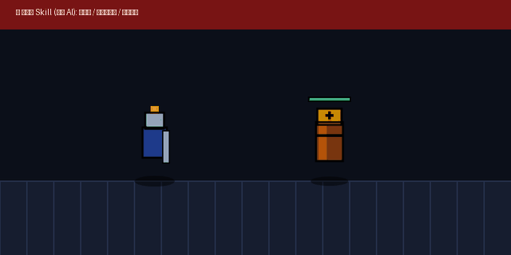

# 游戏手感与打击感调优规范 (game-feel)

游戏手感（Game Feel）不是玄学，而是一套**“视、听、时、空四维神经生理欺骗系统”**。
普通代码只解决“状态与算术”（如 `enemy.hp -= 10`），而高质量的商业游戏通过**顿帧、创伤震屏、形变阻尼与视网膜高频刺激**在大脑中构建真实的“重量、锋利度与力量感”。

---

## 📸 实机效果对比 (Showcase & Comparison)



> **实操对比差异：**
> - **Vanilla 模式（未使用 Skill）**：挥击直接穿过，怪物无形变无受阻，数字匀速直飘，手感如切薄纸。
> - **Juiced 模式（搭载 game-feel）**：命中触发 75ms 强顿挫时空冻结、受击全身白闪 2 帧、Trauma² 非线性创伤震屏、木桩受力横向挤压形变拉伸 1.45 倍、28 颗高初速定向火花切向迸发、8-bit 低频钝击音效同步轰鸣。
> - 本地可双击 `showcase.html` 亲自在战斗试验台按空格键挥刀感受。

---

## 🤖 适配与实测推荐模型 (Model Recommendations)

针对动作游戏打击感与微反馈系统的设计与编码，推荐配合以下大模型使用：

| 任务类型 | 推荐使用模型 | 实测表现与推荐原因 |
|---|---|---|
| **物理手感与时序逻辑编写** | **Gemini 3.8 Flash (High)** *(实测验证模型)* | 本次试验台实测模型。极具游戏策划常识，能严密处理 60FPS 循环下的顿帧阻断、阻尼摩擦衰减与弹簧拉回数学公式。 |
| **底层引擎物理重构与架构** | **Claude 3.7 Sonnet** / **Gemini 3.8 Pro** | 适合处理大规模动作游戏中的碰撞预测、带网络回滚的受击同步（Reconciliation）与分层音画渲染管线。 |
| **受击 Shader 与 Web Audio 合成** | **Gemini 3.8 Pro** / **GPT-4o** | 能准确生成复杂的 GLSL / HLSL 材质覆盖着色器以及基于纯数学公式的实时 Web Audio API 声音合成节点。 |

---

## 1. 六大核心微反馈要素与物理算法

```
[武器击中判定]
   │
   ├─► ① 顿帧 (Hitstop) ───► 时空冻结 40~90ms（赋予刃口切入肉体/护甲的顿挫阻力）
   ├─► ② 白闪 (White Flash) ─► 角色材质纯白高亮 2 帧（视网膜瞬态冲击）
   ├─► ③ 挤压拉伸 (Squash) ──► 面积守恒形变 Sx=1.4, Sy=0.7 随后弹簧阻尼回弹
   ├─► ④ 冲量击退 (Knockback)► 瞬时冲量 Impulse + 指数摩擦阻尼衰减（拒绝匀速平移）
   ├─► ⑤ 创伤震屏 (Screenshake) Trauma² 非线性衰减震动 + 微角度偏转
   └─► ⑥ 定向粒子 (Sparks) ──► 沿斩切法线锥形喷溅高速高亮火花
```

---

### ① 顿帧定格 (Hitstop / Freeze Frame)
- **原理**：命中瞬间，将全局或攻击/受击双方的时空瞬间冻结数帧。
- **推荐时长**：
  - 普通轻击：`30ms ~ 50ms`（约 2~3 帧，轻微顿挫）；
  - 大剑/重击：`70ms ~ 90ms`（约 4~6 帧，厚重骨感）；
  - 致命暴击/破盾：`120ms ~ 180ms`（剧烈时空凝滞）；
- **高级技巧**：
  - 优先使用**局部实体冻结（Local Entity Pause）**，只定格玩家与受击者，让背景粒子与落叶继续飘动，比全局 `Engine.time_scale = 0` 质感更高高级。

### ② 创伤衰减屏幕震屏 (Trauma-based Screenshake)
遵循 Vlambeer 经典非线性公式：**必须使用创伤值的平方（$Trauma^2$）来驱动震幅**。
- **为什么不用单纯随机值？**
  - 普通随机震屏在弱击时晃眼、强击时软弱；
  - $Trauma^2$ 使得轻微受击几乎不察觉，连续/剧烈受击呈指数级爆发！

**数学模型**：
$$\text{ShakeOffset} = \text{MaxOffset} \times \text{Trauma}^2 \times \text{Noise}(t)$$
$$\text{ShakeAngle} = \text{MaxAngle} \times \text{Trauma}^2 \times \text{Noise}(t + 100)$$
$$\text{Trauma} \leftarrow \max(0, \text{Trauma} - \text{Decay} \times \Delta t)$$

### ③ 受击瞬间全白闪烁 (White-out Flash)
- **原理**：受击首帧由 Shader 将精灵全身像素强制渲染为纯白 `#FFFFFF`，持续 `2 ~ 3` 帧（约 30~50ms），随后在 1~2 帧内淡出。
- **禁忌**：直接变红（红屏会遮盖角色本身的贴图细节，视觉发脏；纯白闪烁是世界公认最凌厉的打击信号）。

### ④ 弹性挤压拉伸 (Squash & Stretch)
- **原理**：基于 Disney 动画十二法则与体积守恒定律（$S_x \times S_y \approx 1$）。
- **受击瞬间**：横向受力拉宽至 `1.35 ~ 1.5`，纵向压缩至 `0.65 ~ 0.75`；
- **回弹恢复**：利用弹簧衰减公式（Spring Damper）在 3~4 个振荡周期内平滑归一：
  $$S \leftarrow S + (1 - S) \times \text{Stiffness}$$

### ⑤ 冲量与物理阻尼击退 (Impulse & Friction)
- **绝对禁止**：`position.x += 10` 这种每帧匀速或直接瞬移的写法。
- **标准实现**：
  - 受击瞬间赋予初始冲量速度：`velocity = hit_normal * impulse_power`；
  - 每帧物理更新应用空气/地面阻力：`velocity *= pow(friction, dt)`；
  - 配合微微的击飞重力抛物线。

### ⑥ 爆裂火花与弹跳伤害数字 (Sparks & Pop Floaties)
- **火花粒子**：不要无序球形爆炸，应顺着挥击切线呈 `30° ~ 45°` 锥形高速向外喷射；
- **伤害飘字**：
  - 出现瞬间 `Scale = 2.0`（爆字放大）；
  - 弹跳曲线向上弹起一段，随后快速收缩回 `1.0` 并在上升中渐隐消失。

---

## 2. 引擎端核心实现参考 (以 Godot 4.x 为例)

### 2.1 局部顿帧控制器 (HitstopManager.gd)
```gdscript
extends Node

# 局部顿帧：只冻结目标节点，不污染全局
func freeze_entity(node: CanvasItem, duration: float = 0.08) -> void:
    if not is_instance_valid(node):
        return
    
    # 暂停节点的处理
    node.process_mode = Node.PROCESS_MODE_DISABLED
    await get_tree().create_timer(duration, true, false, true).timeout
    if is_instance_valid(node):
        node.process_mode = Node.PROCESS_MODE_INHERIT

# 全局高压顿帧 (用于大招斩杀)
func freeze_global(duration: float = 0.1, time_scale: float = 0.05) -> void:
    Engine.time_scale = time_scale
    await get_tree().create_timer(duration * time_scale, true, false, true).timeout
    Engine.time_scale = 1.0
```

### 2.2 创伤衰减摄像机震屏 (ShakerCamera2D.gd)
```gdscript
extends Camera2D

@export var max_offset: Vector2 = Vector2(16, 16)
@export var max_angle: float = 0.05
@export var trauma_decay: float = 1.5

var trauma: float = 0.0

func _process(delta: float) -> void:
    if trauma > 0.0:
        trauma = max(trauma - trauma_decay * delta, 0.0)
        _apply_shake()
    else:
        offset = Vector2.ZERO
        rotation = 0.0

func add_trauma(amount: float) -> void:
    trauma = clamp(trauma + amount, 0.0, 1.0)

func _apply_shake() -> void:
    var shake = pow(trauma, 2)
    offset.x = max_offset.x * shake * randf_range(-1.0, 1.0)
    offset.y = max_offset.y * shake * randf_range(-1.0, 1.0)
    rotation = max_angle * shake * randf_range(-1.0, 1.0)
```

### 2.3 受击纯白闪烁 Shader (hit_flash.gdshader)
```glsl
shader_type canvas_item;

uniform bool flash_active = false;
uniform vec4 flash_color : source_color = vec4(1.0, 1.0, 1.0, 1.0);

void fragment() {
    vec4 texture_color = texture(TEXTURE, UV);
    if (flash_active) {
        COLOR = vec4(flash_color.rgb, texture_color.a);
    } else {
        COLOR = texture_color;
    }
}
```

---

## 3. 手感调校验收清单 (Game Feel Checklist)

每次实现战斗受击或操作交互时，逐项核对：

- [ ] **是否感知到质量？** 击中硬质/护甲敌人时是否有顿帧（≥ 60ms）？
- [ ] **震屏是否平滑不眩晕？** 是否采用 Trauma² 衰减模型，而不是简易的定值随机振动？
- [ ] **视觉受力是否有形变？** 受击瞬间是否有 1 帧以上的 Squash & Stretch 物理拉扁？
- [ ] **高频信号是否干脆？** 受击反馈是否是 2 帧干脆的白闪，而非拖泥带水的渐变红？
- [ ] **粒子是否具有方向感？** 火花喷溅方向是否沿武器切线呈定向锥形散布？
- [ ] **听觉冲击是否同步？** 顿帧发生的同一瞬间，低频重击冲击音（Impact thud）是否准时触发？
