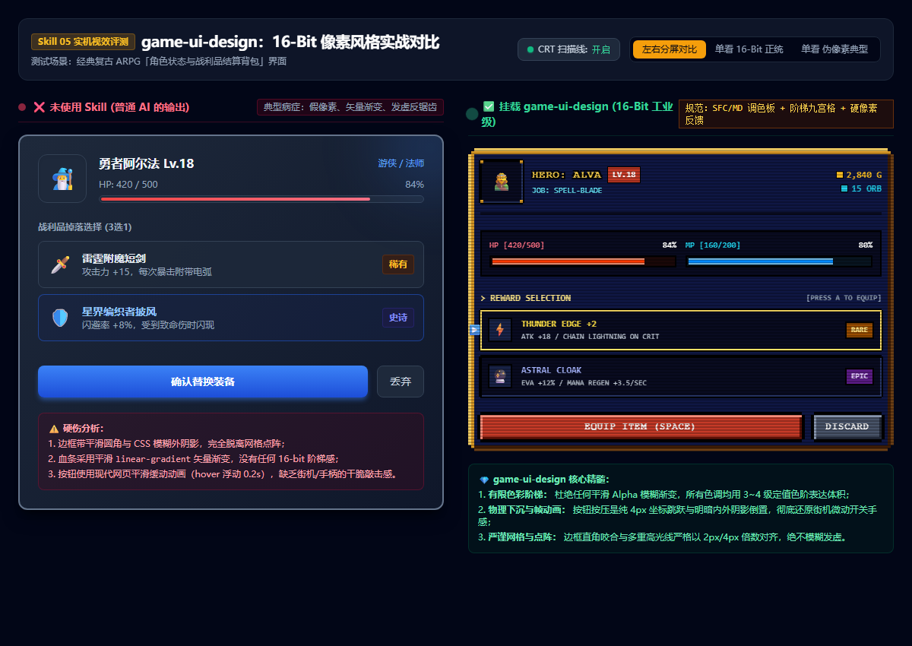

# 16-Bit 游戏 UI 设计规范 (game-ui-design)

在像素游戏中，UI 绝对不是“给普通网页加上黑色边框”。
粗暴使用现代 CSS 模糊阴影、平滑渐变、反锯齿圆角或缓动动画，会制造出严重的**“假像素/缝合怪”**违和感。

本 Skill 旨在确立正统 16-bit 黄金时代（SFC/SNES/MD 及现代经典如《星之海》《八方旅人》）的游戏 UI 设计准则，涵盖**视觉规范、生图提示词、九宫格拉伸切割、纯代码模拟公式及微交互手感**。

---

## 📸 实机效果对比 (Showcase & Comparison)



> **实操对比差异：**
> - **左侧（未使用 Skill - 普通 AI 常见作派）**：反锯齿矢量圆角、平滑线性渐变血条、模糊外发光阴影、现代缓动动画，违和感强烈。
> - **右侧（搭载 game-ui-design）**：正统 16-Bit 阶梯咬合、双层金属嵌套高光、分段阶梯像素血条、逐帧硬跳像素指示箭头、纯物理 4px 下沉手感、支持 CRT 显像管扫描线。
> - 本地可双击 `showcase.html` 打开交互原型体验。

---

## 🤖 适配与实测推荐模型 (Model Recommendations)

为确保本 Skill 提示词与规范发挥出最佳水准，针对不同环节推荐使用以下模型：

| 任务类型 | 推荐使用模型 | 实测表现与推荐原因 |
|---|---|---|
| **UI 代码与交互逻辑生成** | **Gemini 3.8 Flash (High)** *(实测验证模型)* | 推理响应极快，能精准遵循 0ms 物理下沉、无模糊多重 box-shadow 及阶梯 polygon 规则，代码零样板代码负担。 |
| **高复杂度 UI 架构与 Shader** | **Claude 3.7 Sonnet** / **Gemini 3.8 Pro** | 适合生成极其复杂的 Godot 4.x / Unity HLSL 像素着色器与深度嵌套的 NinePatch 布局树。 |
| **像素 UI 边框与图标生图** | **Imagen 3 (Fast / HQ)** / **Gemini 3.8 Flash ImageGen** | 对 `#FF00FF` 品红底与“无外发光、无渐变”负面词约束执行力极强，网格漂移率最低。 |
| **商业级风格概念原画** | **Midjourney v6 (`--style raw`)** | 适合前期用于确立整体复古调色盘与氛围锚点图。 |

---

## 1. 16-Bit 像素 UI 四大铁律

### ① 阶梯有限色阶（Step Ramps，严禁平滑渐变）
- **禁止**使用平滑的 `linear-gradient` 或模糊外发光（Alpha blur）。
- **必须**使用 3~4 级定值色阶表达体积感：
  - **高光线（Highlight）**：1px 亮色（如浅金 `#f6d063`、浅蓝 `#80d0ff`），置于物体左侧与顶边；
  - **基底主体（Midtone）**：中度饱和度基色；
  - **阴影底边（Shadow）**：深沉暗色（如暗褐 `#3d1c06`、暗蓝 `#003888`），置于物体右侧与底边；
  - **外轮廓（Outline）**：纯黑 `#000000` 或深墨色，像素网格对齐。

### ② 整数倍网格与阶梯直角咬合（Stepped Pixel Corners）
- **禁止**现代圆角 `border-radius: 8px`（反锯齿会导致边缘发虚发毛）。
- **必须**使用硬直角点阵堆叠实现的阶梯圆角（Stepped notch / notch polygon），边框宽度严格以 2px / 4px 为单位，保证在任何缩放倍率下横平竖直。

### ③ 纯物理下沉与 0ms 状态反馈（Instant Hand-Feel）
- **禁止**按钮状态过渡动画 `transition: all 0.2s ease`（这属于现代 Web，不是街机/手柄）。
- **必须** 0ms 瞬时状态帧跳跃：
  - **按下状态（Pressed/Active）**：整体图案沿 Y 轴**纯物理下沉 2px ~ 4px**；
  - **高光阴影反转**：按钮凸起时左上为亮、右下为暗；按下后凹陷，左上变为暗色内阴影、右下变为浅色亮边。

### ④ 点阵字与单像素硬投影（Pixel Typography）
- 必须搭配等宽/点阵像素字体（如 Press Start 2P, Ark Pixel 或等宽 Courier 规范）；
- 文字使用**无羽化单像素硬投影**（Drop shadow: `2px 2px #000`）或全方向 1px 描边，确保在任何复杂背景上均清晰可读。

---

## 2. 核心 UI 资产生成提示词模板（配合 Gemini / Midjourney）

UI 资产需送入 `TruePixel` 管线处理，必须严格遵守**纯品红背景 `#FF00FF`、无外发光、无外部投影**原则。

### 2.1 经典双层金属镶嵌面板边框（JRPG Dialogue/Inventory Frame）
```text
Game UI panel frame, ONE single empty rectangular plaque, perfectly symmetrical left-right and top-bottom, orthographic front view, aspect ratio 4:3.
Style: 16-bit SNES classic JRPG aesthetics, chunky crisp square pixels on a strict grid, dark navy blue background (#0f1744), thick ornate double-layered metallic gilt gold border (#f6d063 #d99926 #6c3f15) with 1px black outline.
Design: Decorative corner rivets ONLY in the four corners; all four edges between corners are completely straight, uniform and unadorned for Nine-Slice stretching; the inner center is a solid clean fill with zero texture.
Background: the entire background outside the panel is one flat, uniform, solid magenta color #FF00FF.
Do not add any drop shadow, glow, blur, gradient, semi-transparent pixels, text or watermark.
```

### 2.2 凹陷型装备插槽（Sunken Inventory Slot）
```text
Pixel art game UI icon slot, single square inventory slot, orthographic front view, 64x64 art-pixels.
Style: 16-bit retro game UI, deep sunken recessed bezel, dark obsidian interior (#090b20), inner shadow at top-left, crisp metallic edge highlight at bottom-right, continuous 1px dark border.
Background: the entire background is one solid flat magenta #FF00FF.
Do not add any glow, soft edges or anti-aliasing.
```

### 2.3 阶梯式血条/能量槽底图（Segmented Gauge）
```text
Game UI health bar frame, empty horizontal gauge bar, aspect ratio 8:1, orthographic front view.
Style: 16-bit chunky pixel art, heavy dark iron casing, segmented notch markers every 20%, stepped pixel beveling, high contrast highlights on upper ridge, dark bottom shadow.
Background: the entire background is one solid flat magenta #FF00FF.
Do not add any semi-transparent glass effect or smooth gradients.
```

### 2.4 像素指示小手/光标（Animated Pointer）
```text
Pixel art UI cursor pointer, single golden hand pointing rightwards, 16-bit retro arcade style, bold 1px black outline, bright yellow and amber shading (#ffe066 #d99926), high contrast, side profile view.
Background: pure solid magenta #FF00FF.
Do not add motion blur, trail, shadow or glow.
```

---

## 3. 纯代码 16-Bit UI 渲染规范（免图纯代码方案）

当无需外部生图、直接在 Web / DOM / Canvas 构建 16-Bit UI 时，使用多重 `box-shadow` 构造纯正双层嵌边：

### ① 16-Bit 双层立体金边面板（CSS 纯代码实现）
```css
.snes-frame-pure {
  background: #0f1744;
  position: relative;
  /* 核心：用纯零模糊的多重阴影构建内嵌金属高光与外黑边 */
  box-shadow: 
    0 -4px 0 0 #000,
    0 4px 0 0 #000,
    -4px 0 0 0 #000,
    4px 0 0 0 #000,
    inset 4px 4px 0 0 #f6d063,   /* 左上金色外高光 */
    inset -4px -4px 0 0 #6c3f15, /* 右下深褐外阴影 */
    inset 8px 8px 0 0 #d99926,   /* 次层暖金 */
    inset -8px -8px 0 0 #3d1c06; /* 次层焦褐 */
}
```

### ② 阶梯缺角剪裁（Stepped Corner Polygon）
```css
.snes-corner-cut {
  clip-path: polygon(
    0 8px, 4px 8px, 4px 4px, 8px 4px, 8px 0,
    calc(100% - 8px) 0, calc(100% - 8px) 4px, calc(100% - 4px) 4px, calc(100% - 4px) 8px, 100% 8px,
    100% calc(100% - 8px), calc(100% - 4px) calc(100% - 8px), calc(100% - 4px) calc(100% - 4px), calc(100% - 8px) calc(100% - 4px), calc(100% - 8px) 100%,
    8px 100%, 8px calc(100% - 4px), 4px calc(100% - 4px), 4px calc(100% - 8px), 0 calc(100% - 8px)
  );
}
```

### ③ 街机微动按钮（按压下沉 4px 物理位移）
```css
.snes-btn {
  background: #c53a27;
  box-shadow: 
    0 -4px 0 0 #000, 0 4px 0 0 #000, -4px 0 0 0 #000, 4px 0 0 0 #000,
    inset 3px 3px 0 0 #ff8e7b,
    inset -3px -3px 0 0 #5c1106;
  transition: none; /* 绝对禁止过渡动画 */
}
.snes-btn:active {
  transform: translateY(4px); /* 瞬间下沉 */
  box-shadow: 
    0 -2px 0 0 #000, 0 2px 0 0 #000, -4px 0 0 0 #000, 4px 0 0 0 #000,
    inset 3px 3px 0 0 #5c1106,  /* 阴影与高光对调，形成凹陷 */
    inset -3px -3px 0 0 #ff8e7b;
}
```

---

## 4. 接入引擎与 TruePixel 后处理管线

生成的 UI 边框原图在经过 TruePixel 管线时：
1. **执行模式**：UI 边框必须使用 `--native` 模式，确保拉伸边上的像素不被最近邻重抽样打乱；
   ```powershell
   $env:PYTHONIOENCODING="utf-8"
   python -m truepixel single <raw_frame.png> <output_frame.png> --native --palette <palette.png>
   ```
2. **Godot 引擎 NinePatchRect 配置**：
   - 检查角花宽度（例如 16 逻辑像素）；
   - 在 Godot 检查器中将 `Patch Margin`（Left, Top, Right, Bottom）统一设为对应角花像素值；
   - `Axis Stretch`（水平与垂直）设置为 `Tile`（平铺）或 `Stretch`（平滑拉伸），保证边框不形变。

---

## 5. 验收检查清单（UI 专项）

- [ ] **无亚像素模糊**：放大 400% 观察，是否有非整数网格的半透明杂色边？
- [ ] **九宫格可伸缩性**：四个角落以外的边缘线是否绝对平直、无突变杂点？
- [ ] **高光方向统一步调**：面板、插槽、按钮的光源是否统一来自左上方（Top-Left）？
- [ ] **状态按压反馈**：按下时是否有纯坐标位移（下沉 2~4px）而非现代网页渐变？
- [ ] **文本可读性**：在深色面板或复杂场景上，文本是否有 1px 黑色硬描边或阴影衬托？
