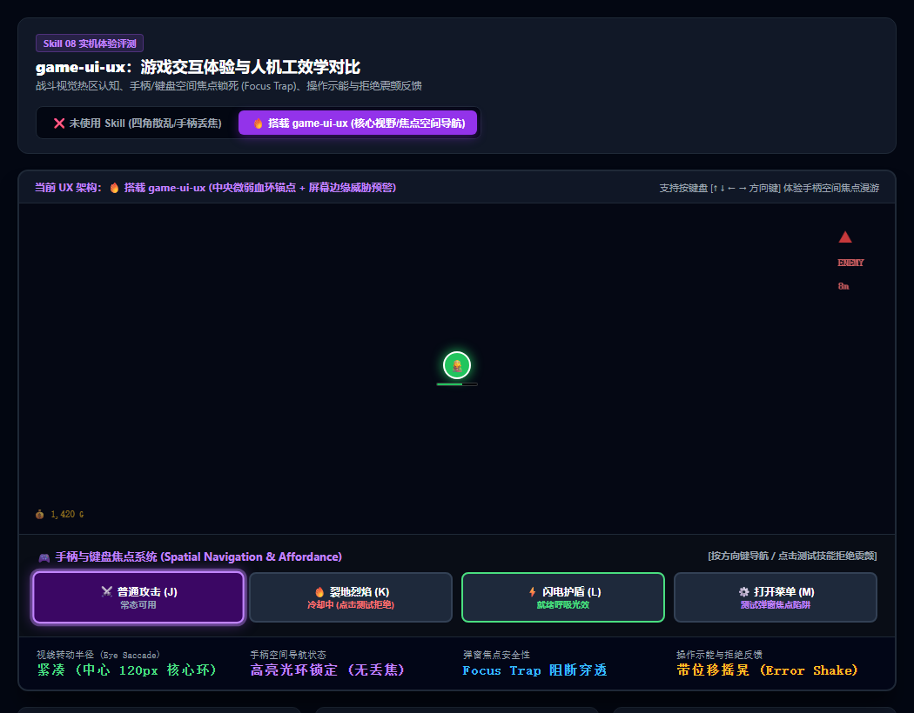

# 游戏 UI/UX 交互体验与人机工效学规范 (game-ui-ux)

很多人容易把 **UI 设计（Visual Design）** 与 **UX 体验（User Experience）** 混为一谈：
- UI 设计（Skill 05）解决的是“好看、像素调色板、九宫格拉伸、质感”；
- 而 **UI/UX（本 Skill 08）** 解决的是**“好用、不累、直觉、人机工效学与手柄键盘无障碍闭环”**。

普通 AI 写出来的游戏界面往往四角堆满杂乱信息，打起仗来眼睛来回狂扫，手柄按键经常丢焦甚至点穿弹窗。  
本 Skill 旨在确立主机与商业游戏标准的人机交互规范。

---

## 📸 实机 HUD 热区与手柄焦点测试参考图

> **实机体验：**
> * **❌ 未使用 Skill（四角堆砌 / 丢焦穿透）**：左上角血条、右上角小地图、右下角技能，玩家视线在 800px 广阔屏幕间剧烈拉扯，根本看不见脚底危险；弹窗出来后按手柄按键，直接点穿到背景释放技能；
> * **✅ 搭载 game-ui-ux（工业级人机交互）**：
>   * **核心环形视野（Inner Anchor）**：角色脚底微弱弧形血条，眼球零位移；屏幕边缘弧形威胁指示标（Off-screen Indicator）提前预判敌情；
>   * **手柄空间焦点系统（Spatial Navigation）**：支持高亮焦点环漫游，弹窗出现瞬间触发 **Focus Trap（焦点陷阱）** 绝对阻断穿透；
>   * **拒绝摇晃微反馈（Error Shake）**：冷却中点击产生 0.35s 物理拒绝横向摇晃，即时告之大脑机制拒绝。

---

## 🎯 游戏人机交互三大支柱体系

### ① 视网膜工效学：中心热区 vs 全屏视线拉扯 (Visual Saccades)
* **翻车病症**：把重要信息散落在屏幕死角。玩家在躲避密集弹幕时，必须把眼球大幅挪到左上角看血量，导致发生**视觉隧道现象（Tunnel Vision）**，经常出现“玩家满血暴毙都不知道怎么掉的”。
* **交互解法**：遵循 **人类视野 FOV 核心环形原则**：
  * **核心交互区（半径 120px 内）**：仅在玩家角色脚底显示最关键的微弱弧形生命/耐力槽与受击警示；
  * **周边信息区（Peripheral Zone）**：屏幕边缘的血条与金币采用**智能动态隐退（Smart Auto-fade）**，仅在脱战或数值变化时显现；
  * **屏幕边缘威胁指示器（Off-screen Threat Indicators）**：屏幕外发射暗箭或高速冲锋的精英怪，在屏幕边缘投射呼吸三角标与距离，给玩家充足的战术反应时间。

### ② 手柄与键盘空间焦点系统 (Spatial Navigation & Focus Trap)
* **翻车病症**：只考虑了鼠标点击 `onClick`。
  * 玩家用手柄摇杆或键盘 Tab 导航时，根本不知道当前选中的是哪个按钮（无高对比焦点环）；
  * 最致命的是：弹出“暂停/购买”弹窗时，按手柄确认键，**竟然把弹窗后面的战斗大招一起按响了（Focus Leak 焦点穿透）**！
* **交互解法**：建立 **状态机焦点管理器（Focus Manager）**：
  * **空间几何推导（Spatial Proximity）**：按下方向键时，自动向射线方向寻找最近的邻居按钮激活高亮外发光环；
  * **焦点陷阱（Focus Trap / Modal Lock）**：二级弹窗激活瞬间，所有手柄输入流被强制锁死在弹窗内部，无法穿透背景；
  * **焦点记忆（Focus Memory）**：关闭弹窗后，光标毫秒级复位至呼出前的主界面按钮，杜绝丢焦。

### ③ 操作示能与拒绝震颤反馈 (Affordance & Error Shake)
* **翻车病症**：技能冷却中（Cooldown）或蓝量不足时，按钮处于不可用状态。玩家点击时界面毫无动静，玩家以为游戏卡死了，焦躁地疯狂狂按按键。
* **交互解法**：提供 **清晰的神经生理微交互闭环**：
  * **机制拒绝（Rejection Feedback）**：不可用时点击，按钮瞬间发生 **0.35s 物理水平摇晃（Error Shake）+ 警示红闪 + 低频拒绝音**，即刻消除卡死疑惑；
  * **就绪呼吸光效（Readiness Sheen）**：冷却完毕瞬间，按钮图标边缘产生一次微幅缩放与高光扫光（Sheen Pulse），利用人类对边缘动态敏感的本能提醒玩家“技能已就绪”。

---

## 🌐 核心应用场景清单

| 业务场景 | 典型代表作品 | 本 Skill 的核心作用 |
|---|---|---|
| **1. 动作、肉鸽与射击战斗 HUD** | 《黑帝斯》《战神》《无主之地》 | 控制认知负荷，核心信息脚底内嵌，屏幕外威胁边缘引导，视线不离战场。 |
| **2. 主机手柄与 Steam Deck 移植** | 全平台手柄支持游戏 | 空间焦点导航、改键支持、二级菜单 Focus Trap 锁死，彻底杜绝手柄丢焦穿模。 |
| **3. 复杂技能面板与战术轮盘** | 《艾尔登法环》《怪物猎人》 | 技能状态微交互闭环（冷却拒绝摇晃、充能完毕光晕呼吸、缺蓝警示）。 |
| **4. 商业化弹窗与背包仓库管理** | 装备强化、二次确认弹窗 | 焦点陷阱阻断物理输入流穿透，防止玩家在确认弹窗背后误触发危险操作。 |

---

## 🤖 适配与实测推荐模型 (Model Recommendations)

| 任务类型 | 推荐使用模型 | 实测表现与推荐原因 |
|---|---|---|
| **手柄空间导航与焦点陷阱代码** | **Gemini 3.8 Flash (High)** *(实测验证推荐)* | 逻辑极为紧凑，能精准处理焦点栈（Focus Stack）、弹窗锁死与键盘事件拦截。 |
| **HUD 布局工效学与屏幕外计算** | **Claude 3.7 Sonnet** / **Gemini 3.8 Pro** | 几何视锥体投影推导极强，擅长计算屏幕边缘视口钳位（Viewport Clamping）。 |
| **微交互动画与人机工效评审** | **Claude 3.7 Sonnet** | 极度熟悉 Nielsen 人机交互原则与无障碍可访问性（Accessibility），能快速挑出交互断点。 |
