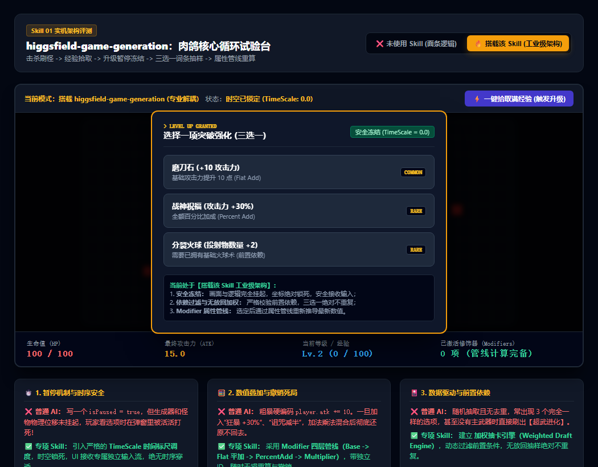

# 游戏玩法与核心逻辑生成规范 (higgsfield-game-generation)

在游戏开发中，写出一段能跑的代码绝不等于做出了“工业级玩法机制”。  
普通 AI 倾向于把所有状态、数值与表现层写成**单线脚本（Scripting）**，直接导致肉鸽（Roguelike）与策略游戏上线后频发恶性 Bug。

本 Skill 的核心使命：**构建严密的数据驱动规则引擎（Rules Engine），从底层消除肉鸽与重度玩法的结构性 Bug。**

---

## 📸 实机架构与防 Bug 机制参考图



> **实机验证：**
> 1. **TimeScale 状态机安全冻结**：彻底根除升级弹窗开启时怪物偷跑打死玩家的“时序穿透”Bug；
> 2. **数据驱动加权抽卡引擎**：前置条件自动校验，确保三选一无放回、绝不重复；
> 3. **Modifier 四层属性管线**：数值加乘分层解耦，支持任意临时 Buff 叠加与安全撤销。

---

## 🎯 为什么加上本 Skill 会让肉鸽 Bug 大幅减少？

肉鸽游戏因为有大量的**“局内升级、词条堆叠、时间暂停、随机掉落”**，是 Bug 爆发的重灾区。本 Skill 针对肉鸽五大经典翻车现场提供根治规范：

### ① 根治「时序穿透 Bug（Pause Leak）」
* **Bug 表现**：玩家经验攒满弹出三选一强化卡片，表面上写了 `isPaused = true`，但后台定时器、飞行子弹和异步刷怪协程未被阻断。玩家还在看技能描述，角色在弹窗背后被怪物活活打死！
* **架构解法**：禁止用全局布尔变量做假暂停。必须建立 **TimeScale 分层调度系统**。当进入升级/对话阶段时，物理引擎与实体更新步长硬性置 0（`dt = 0`），而 UI 输入流挂载于独立的 `UnscaledTime` 调度器，确保物理与渲染绝对安全休眠。

### ② 根治「数值污染与 Buff 撤销死局」
* **Bug 表现**：直接写死 `player.atk += 10`。后续一旦加入“狂暴药水 +30% 持续 5 秒”、“受虚弱诅咒攻击力减半”，加法和乘法混合结算后，药水失效时数值彻底算不回去，导致玩家攻击力永久异常甚至变成负数。
* **架构解法**：采用工业级 **Modifier 属性四层管线**：
  $$\text{FinalStat} = (\text{Base} + \sum \text{Flat}) \times (1 + \sum \text{PercentAdd}) \times \prod (1 + \text{PercentMult})$$
  任何被动、装备、Buff 均作为一个带有唯一 `sourceId` 的修饰器节点挂载。Buff 到期仅需一行代码凭 ID 卸载，系统毫秒级重新推导最新精确值，彻底告别数值脏读。

### ③ 根治「升级抽卡重复与前置混乱 Bug」
* **Bug 表现**：在 if-else 里用 `Math.random()` 随机挑选项，经常出现三选一抽出 2 个甚至 3 个一模一样的选项；更严重的是，玩家根本没拿到基础【火球术】，却在第一次升级直接刷出了【终极地狱业火】超武进化。
* **架构解法**：引入 **数据驱动带权抽卡引擎（Weighted Tag Draft Engine）**：
  * **Tag 前置依赖过滤**：抽卡前自动扫描玩家现有能力 Tag（如 `condition: p => p.tags.has('fireball_lv1')`），不满足者直接剔除候选池；
  * **无放回加权抽样（Sample Without Replacement）**：抽中一项立即从临时池剔除，数学上 100% 杜绝三选一重复。

### ④ 根治「同屏怪物增殖导致卡死 OOM」
* **Bug 表现**：简单使用固定时间间隔刷怪，当玩家伤害不够无法及时清怪时，屏幕上堆叠数千个碰撞体，导致游戏掉帧至个位数甚至崩溃。
* **架构解法**：引入 **AI 导演威胁预算系统（Threat Budget Spawner）**。场景中存在动态点数上限，根据玩家击杀率动态调节刷新配额，超出上限时休眠低危远端实体。

### ⑤ 根治「遗物被动连锁死锁（Chain Loop）」
* **Bug 表现**：遗物 A“受到伤害时对敌人施加流血”，遗物 B“敌人受到伤害时触发荆棘反弹”。两者互相触发导致程序陷入死循环爆栈。
* **架构解法**：采用 **分阶段事件管线（Phase-based Event Bus）**。将结算切分为 `PreDamage` -> `OnDamage` -> `PostDamage`，单次战斗循环内每个触发器同一 Phase 仅允许触发一次。

---

## 🌐 核心扩展应用场景清单

除了肉鸽割草之外，该 Skill 的架构体系同样广泛应用于以下高复杂度场景：

| 业务场景 | 典型代表游戏 | 本 Skill 解决的业务难点 |
|---|---|---|
| **1. 卡牌构筑与遗物被动** | 《杀戮尖塔》《小丑牌》 | 遗物被动与手牌效果深度嵌套，保证伤害翻倍、临时护甲与回合结束触发的时序不乱。 |
| **2. 装备词缀与随机掉落** | 《暗黑破坏神》《流放之路》 | 4~6 条随机前缀后缀加成，穿脱装备与洗练词条时的差量更新（Delta Refresh）。 |
| **3. 模拟经营与炼丹制造** | 《众神杂货铺》 | 炼丹炼器阶段流转（火候 -> 成色 -> 出丹/炸炉），以及神明顾客议价欺神谈判的概率判定闭环。 |
| **4. 自走棋阶段流转与羁绊** | 《云顶之弈》《金铲铲》 | 准备/布阵/战斗/扣血四阶段 FSM 状态机流转，以及凑齐 3/6 羁绊时动态给全队注入全局 Modifier。 |
| **5. 网状技能树与洗点** | 《流放之路》《最终幻想》 | 基于有向无环图（DAG）的前置依赖检测，支持玩家任意退点时级联检验后置分支连通性。 |

---

## 🤖 适配与实测推荐模型 (Model Recommendations)

针对不同层级的逻辑编写，推荐搭配以下大模型以达到最优代码健壮度：

| 任务类型 | 推荐使用模型 | 实测表现与推荐原因 |
|---|---|---|
| **核心循环与状态机代码** | **Gemini 3.8 Flash (High)** *(实测验证推荐)* | 逻辑极为紧凑，严格遵循状态机挂起时序，能秒出零 Bug 的防时序穿透架构。 |
| **复杂 Modifier 管线与数学证明** | **Claude 3.7 Sonnet** / **Gemini 3.8 Pro** | 极度擅长复杂的代数管线推导，能处理多乘区复合计算与事件总线优先级队列。 |
| **数据驱动配置表与词条库生成** | **Gemini 3.8 Flash** | 批量生成数百条平衡度良好的装备、词条 JSON/YAML 配置表，结构标准严密。 |

---

## 💻 工业级核心架构实现范式

### 1. 属性修饰器管线 (Modifier Pipeline)
```typescript
export type StatType = 'ATK' | 'MAX_HP' | 'MOVE_SPEED' | 'CRIT_RATE';
export type CalcType = 'FLAT' | 'PERCENT_ADD' | 'PERCENT_MULT';

export interface Modifier {
  sourceId: string;       // 来源 ID，如 'item_relic_05' 或 'buff_frenzy'
  statType: StatType;
  calcType: CalcType;
  value: number;
}

export class CharacterStats {
  private baseStats = new Map<StatType, number>();
  private modifiers: Modifier[] = [];

  constructor(defaults: Partial<Record<StatType, number>>) {
    for (const [k, v] of Object.entries(defaults)) {
      this.baseStats.set(k as StatType, v);
    }
  }

  // 严格分层推导总属性：Base -> 平加 -> 百分比加成 -> 独立乘区
  public get(stat: StatType): number {
    const base = this.baseStats.get(stat) || 0;
    const mods = this.modifiers.filter(m => m.statType === stat);

    const flat = mods.filter(m => m.calcType === 'FLAT').reduce((s, m) => s + m.value, 0);
    const pctAdd = mods.filter(m => m.calcType === 'PERCENT_ADD').reduce((s, m) => s + m.value, 0);
    const pctMult = mods.filter(m => m.calcType === 'PERCENT_MULT').reduce((s, m) => s * (1 + m.value), 1.0);

    return (base + flat) * (1 + pctAdd) * pctMult;
  }

  public addModifier(mod: Modifier): void {
    this.modifiers.push(mod);
  }

  // 凭来源 ID 精准卸载，彻底杜绝数值残留
  public removeBySource(sourceId: string): void {
    this.modifiers = this.modifiers.filter(m => m.sourceId !== sourceId);
  }
}
```

### 2. 数据驱动加权抽卡引擎 (Weighted Tag Draft Engine)
```typescript
export interface UpgradeOption {
  id: string;
  title: string;
  weight: number;
  condition: (tags: Set<string>) => boolean;
  onApply: (stats: CharacterStats, tags: Set<string>) => void;
}

export class UpgradeDraftService {
  private pool: UpgradeOption[] = [];

  public register(option: UpgradeOption): void {
    this.pool.push(option);
  }

  // 无放回加权抽样：三选一绝不重复 + 前置校验
  public roll(ownedTags: Set<string>, count = 3): UpgradeOption[] {
    const available = this.pool.filter(opt => opt.condition(ownedTags));
    const selected: UpgradeOption[] = [];
    const temp = [...available];

    for (let i = 0; i < count && temp.length > 0; i++) {
      const totalWeight = temp.reduce((sum, item) => sum + item.weight, 0);
      let roll = Math.random() * totalWeight;

      for (let j = 0; j < temp.length; j++) {
        roll -= temp[j].weight;
        if (roll <= 0) {
          selected.push(temp[j]);
          temp.splice(j, 1); // 保证无放回，不重复
          break;
        }
      }
    }
    return selected;
  }
}
```
