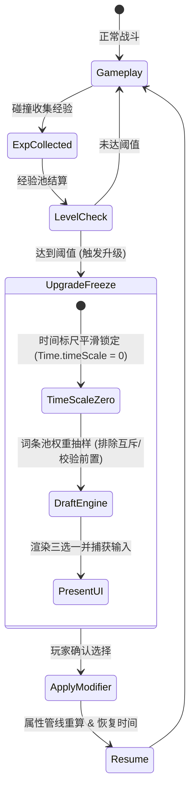

# 游戏玩法与核心逻辑生成规范 (higgsfield-game-generation)

在游戏开发中，写出一段能跑的代码不等于做出了“游戏机制”。
普通 AI 倾向于把状态、数值和表现层全部揉在全局变量与单文件循环中，导致时序穿透、数值无法叠加撤销、词条死循环等致命架构硬伤。

本 Skill 强制 AI 按照游戏设计规范（数据驱动、状态机闭环、可扩展数值管线）来构建核心逻辑。

---

## 🤖 适配与实测推荐模型 (Model Recommendations)

| 任务类型 | 推荐使用模型 | 实测表现与推荐原因 |
|---|---|---|
| **核心循环与状态机架构** | **Gemini 3.8 Flash (High)** / **Claude 3.7 Sonnet** | 能严密遵循 FSM（有限状态机）与发布订阅模式，杜绝死锁与异步状态穿透。 |
| **数值管线与 Modifier 系统** | **Claude 3.7 Sonnet** / **Gemini 3.8 Pro** | 适合设计工业级复杂数值公式（平加、百分比加成、独立乘区）与装备词条叠加解耦。 |
| **升级抽卡与概率加权算法** | **Gemini 3.8 Flash (High)** | 代码精炼无冗余，快速生成轮盘加权随机算法（Weighted Random Sample Without Replacement）。 |

---

## 1. 核心玩法逻辑架构流



---

## 2. 规范的属性管线设计 (Modifier 模式)

解决数值叠加、临时 Buff 衰减与武器演变难以维护的死局：

```typescript
export interface Modifier {
    sourceId: string;
    statType: 'ATK' | 'BOUNCE' | 'COOLDOWN';
    calcType: 'FLAT' | 'PERCENT_ADD' | 'PERCENT_MULT';
    value: number;
}

export class CharacterStats {
    private baseStats: Map<string, number> = new Map();
    private modifiers: Modifier[] = [];

    // 计算总属性：Base -> 平加 -> 百分比加成 -> 独立乘区
    public get(stat: string): number {
        const base = this.baseStats.get(stat) || 0;
        const mods = this.modifiers.filter(m => m.statType === stat);
        
        const flat = mods.filter(m => m.calcType === 'FLAT').reduce((a, b) => a + b.value, 0);
        const percentAdd = mods.filter(m => m.calcType === 'PERCENT_ADD').reduce((a, b) => a + b.value, 0);
        
        return (base + flat) * (1 + percentAdd);
    }

    public addModifier(mod: Modifier) {
        this.modifiers.push(mod);
    }

    public removeModifiersBySource(sourceId: string) {
        this.modifiers = this.modifiers.filter(m => m.sourceId !== sourceId);
    }
}
```

---

## 3. 数据驱动的抽样池 (UpgradeDraftService)

```typescript
export interface UpgradeOption {
    id: string;
    title: string;
    tier: 'COMMON' | 'RARE' | 'LEGENDARY';
    weight: number;
    condition: (player: CharacterStats) => boolean;
    onApply: (player: CharacterStats) => void;
}

export class UpgradeDraftService {
    private pool: UpgradeOption[] = [];

    public rollOptions(player: CharacterStats, count = 3): UpgradeOption[] {
        // 过滤不满足前置条件的词条
        const available = this.pool.filter(opt => opt.condition(player));
        
        // 轮盘加权随机抽样（不放回）
        const selected: UpgradeOption[] = [];
        const tempPool = [...available];

        for (let i = 0; i < count && tempPool.length > 0; i++) {
            const totalWeight = tempPool.reduce((sum, item) => sum + item.weight, 0);
            let roll = Math.random() * totalWeight;

            for (let j = 0; j < tempPool.length; j++) {
                roll -= tempPool[j].weight;
                if (roll <= 0) {
                    selected.push(tempPool[j]);
                    tempPool.splice(j, 1);
                    break;
                }
            }
        }
        return selected;
    }
}
```
