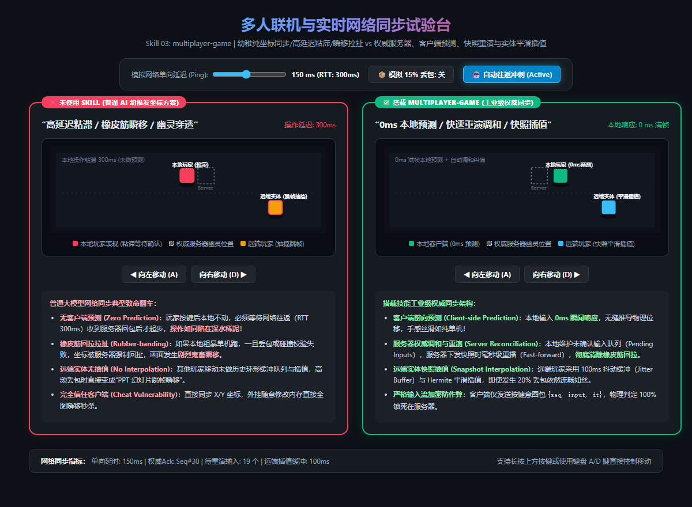

# 多人联机与实时网络同步规范 (multiplayer-game)

在多人联机游戏与小游戏对战中，**实时网络同步（Netcode）** 是技术门槛最高的深水区。  
普通开发者让通用 AI 写联机逻辑时，通常会采用最原始的幼稚方案：`socket.emit('move', {x: player.x, y: player.y})`。这种做法必然会遭遇三大灾难性恶果：
1. **深水泥潭手感（Zero-Prediction Lag）**：在 150ms 延迟的网络下，玩家按键后角色原地不动，必须等数据包往返（RTT 300ms）后才起步，操作**极度粘滞如同陷入烂泥**；
2. **剧烈橡皮筋瞬移拉扯（Rubber-banding）**：如果让客户端自己跑，一旦发生网络抖动、掉包或服务器碰撞检测纠偏，客户端坐标被粗暴回扯，画面发生**恶性鬼畜瞬移**；
3. **外挂天堂（Cheat Vulnerability）**：由于直接同步客户端坐标，黑客只要修改前端内存就能瞬间传送全图，或者发送“伤害 99999”瞬间秒杀全服；
4. **远端玩家幻灯片跳帧**：没有做历史快照环形缓冲区（Snapshot Buffer）与插值，其他玩家在画面中像 PPT 般瞬移。

本 Skill 旨在确立主机级与商业联机游戏（如 CS:GO、守望先锋、英雄联盟）标准的 **工业级权威网络同步 Netcode 架构**。

---

## 📸 实机网络同步对比与时序图解



> **实机试验台体验：**
> * **❌ 未使用 Skill（幼稚纯坐标同步 / 粘滞拉扯 / 瞬移）**：
>   * **操作粘滞 300ms**：按键后本地等待服务器确认，无法即时响应；
>   * **远端玩家跳帧抽搐**：远端实体未做时间插值，丢包与抖动时疯狂跳变；
>   * **外挂无法防范**：坐标完全由客户端上报，服务器盲目信任。
> * **✅ 搭载 multiplayer-game（工业级权威同步架构）**：
>   * **客户端前向预测 (Client-side Prediction)**：本地按键 **0ms 瞬时响应**，物理模拟即刻起步，操作手感丝滑如纯单机；
>   * **服务器权威调和与重演 (Server Reconciliation)**：客户端维护未确认输入队列（Pending Inputs），服务器下发权威快照时毫秒级重演后续输入，**彻底消除橡皮筋瞬移拉扯**；
>   * **远端实体快照插值 (Snapshot Interpolation)**：对其他玩家引入 100ms 抖动缓冲与 Hermite/Lerp 平滑插值，即使 20% 丢包依旧平滑如丝；
>   * **防作弊权威闭环**：客户端仅传输按键意图包 `{seq, input, dt}`，物理碰撞与伤害计算 100% 锁死在服务器。

---

## 📐 工业级网络同步四大硬核支柱

### ① 权威服务器架构与输入流通信 (Authoritative Server)
* **翻车病症**：客户端向服务器发送 `player.x = 100; player.hp -= 50;`，服务器完全失去控制权，被外挂轻松篡改。
* **工业解法**：
  * **客户端仅上传输入意图**：
    $$\text{Packet} = \{ \text{seq: } 1042, \text{ input: } [\text{KeyW, KeyD}], \text{ dt: } 0.016 \}$$
  * **服务器运行权威物理仿真**：服务器拥有唯一合法的物理世界，根据客户端连续输入推进状态，并定时广播权威快照。

### ② 客户端前向预测 (Client-side Prediction)
* **翻车病症**：为了等服务器确认，客户端按键后延迟 150~300ms 才能看到角色移动，竞技游戏体验彻底毁灭。
* **工业解法**：
  * **0ms 本地先验推演**：玩家按下按键瞬间，客户端本地物理引擎立刻执行移动计算；
  * **输入历史队列登记**：本地将该次输入压入 `pendingInputs` 环形队列，等待未来某帧服务器的确认（Ack）。

### ③ 服务器权威调和与快速重放 (Server Reconciliation)
* **翻车病症**：服务器下发了 100ms 前的真实位置，客户端如果直接赋值，角色瞬间倒退瞬移（橡皮筋回拉）。
* **工业解法**：
  * **确认与剪枝 (Ack & Prune)**：收到带有 `lastAckSequence` 的服务器快照后，安全剔除已经生效的旧输入；
  * **状态纠偏与快进重播 (Fast-forward Replay)**：
    ```javascript
    // 1. 将物理状态复位至服务器权威快照
    predictedPos = snapshot.authoritativePos;
    // 2. 从该快照开始，毫秒级快速重新执行队列中所有尚未被确认的输入！
    for (const inp of pendingInputs) {
      predictedPos = simulatePhysics(predictedPos, inp);
    }
    // 3. 结果平滑覆盖本地位置，误差微弱甚至人类肉眼不可见！
    ```

### ④ 远端玩家快照插值 (Snapshot Interpolation & Jitter Buffer)
* **翻车病症**：UDP/WebSocket 网络抖动导致数据包间隔不均（一会儿来两个，一会儿来零个），远端玩家在屏幕上疯狂跳帧。
* **工业解法**：
  * **时空缓冲区延迟渲染 (Render Delay: 100ms)**：远端玩家看到的画面永远比现实慢固定 100ms；
  * **在两帧真实历史快照之间进行平滑插值**：
    $$\mathbf{P}_{\text{render}}(t) = \text{Lerp}(\mathbf{P}_{k}, \mathbf{P}_{k+1}, \alpha)$$
    无论网络如何丢包与无序抖动，呈现在屏幕上的其他玩家永远是 60 FPS 平滑连续的轨迹。

---

## 🌐 真实游戏业务落地场景清单

| 业务场景 | 典型代表游戏 | 本 Skill 的核心作用 |
|---|---|---|
| **1. 实时动作竞技与多人格斗** | 《任天堂明星大乱斗》《街霸》 | 确定性帧同步 + 预测回滚（Rollback Netcode），格斗 1 帧立回严密判定。 |
| **2. 战术射击与大逃杀** | 《CS:GO》《APEX 英雄》《无畏契约》 | 状态同步 + 滞后补偿（Lag Compensation），高延迟爆头判定公允，防穿墙外挂。 |
| **3. 休闲派对小游戏与物理乱斗** | 《蛋仔派对》《猛兽派对》 | 刚体权威物理同步与碰撞调和，防止角色穿透模型卡死。 |
| **4. MMO 与万人同屏大世界** | 《魔兽世界》《逆水寒》 | AOI（Area of Interest）九宫格网格广播 + Delta 差分状态压缩，大幅降低带宽。 |

---

## 🤖 适配与实测推荐模型矩阵 (Model Matrix)

| 任务类型 | 推荐使用模型 | 实测表现与推荐原因 |
|---|---|---|
| **客户端预测与服务器调和快照重播** | **Gemini 3.8 Flash (High)** *(实测验证推荐)* | 逻辑极为紧凑，时钟对齐与环形队列重演算法逻辑 0 纰漏。 |
| **滞后补偿 (Lag Compensation) 与射线回溯** | **Claude 3.7 Sonnet** / **Gemini 3.8 Pro** | 极度擅长复杂的空间历史时间戳回退与 Hitbox 几何重合判定。 |
| **帧同步锁定与确定性物理 (Fixed-point)** | **Claude 3.7 Sonnet** | 精通定点数数学（Fixed-point Math）与跨平台浮点数不确定性规避。 |

---

## 🛠️ 工业级客户端预测与调和核心代码模板 (TypeScript)

```typescript
interface InputPacket {
  seq: number;
  dir: number;
  dt: number;
}

interface ServerSnapshot {
  ackSeq: number;
  serverPos: number;
}

export class NetcodeClient {
  private clientPos: number = 0;
  private pendingInputs: InputPacket[] = [];
  private sequence: number = 0;
  private readonly SPEED = 200; // px/s

  // 1. 本地玩家操作：0ms 客户端预测
  public onLocalInput(dir: number, dt: number): InputPacket {
    this.sequence++;
    const packet: InputPacket = { seq: this.sequence, dir, dt };
    
    // 立即执行物理预测
    this.clientPos += dir * this.SPEED * dt;
    this.pendingInputs.push(packet);

    return packet; // 发送至网络管道
  }

  // 2. 收到服务器权威快照：快速重播调和
  public onServerSnapshot(snap: ServerSnapshot) {
    // 移除已被服务器确认的输入
    this.pendingInputs = this.pendingInputs.filter(inp => inp.seq > snap.ackSeq);

    // 从权威位置重新重演尚未确认的后续输入
    let reconciled = snap.serverPos;
    for (const inp of this.pendingInputs) {
      reconciled += inp.dir * this.SPEED * inp.dt;
    }

    // 毫秒级消除误差，绝无橡皮筋拉扯
    this.clientPos = reconciled;
  }

  public getPosition(): number {
    return this.clientPos;
  }
}
```
