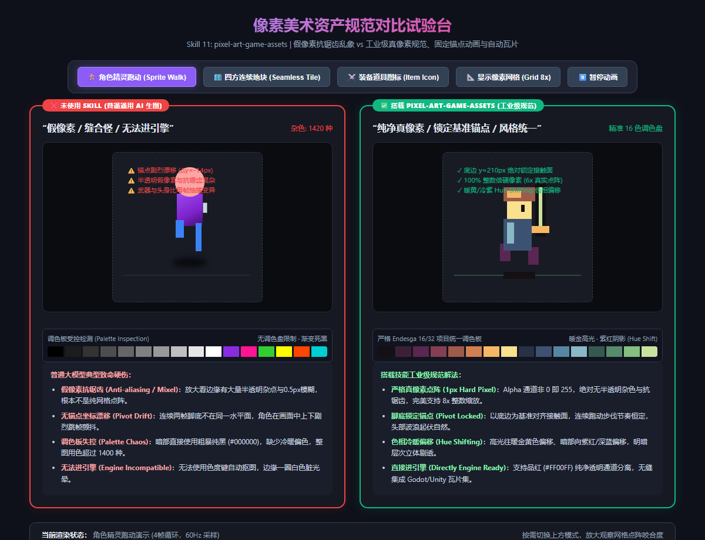

# 像素游戏美术资产与精灵表规范 (pixel-art-game-assets)

在独立游戏与小游戏开发中，美术资产占开发周期的 50% 以上。很多人尝试用通用大模型生图，却发现根本**无法直接导入游戏引擎（Godot / Unity / Cocos）**：
- 画面看起来像像素，放大一看边缘全是半透明杂边和 0.5px 模糊（**“假像素”与抗锯齿灾难**）；
- 同一个画面里有的像素大、有的像素小（**Mixel 混合像素诅咒**）；
- 角色跑动动画两帧之间脚底坐标上下错位 10px，贴在地面上跑时**剧烈抽搐漂浮**；
- 地块素材拼在地图上接缝处有明显的黑白裂缝，根本做不到无缝自适应衔接。

本 Skill 旨在确立主机级与商业复古像素游戏的工业级美术标准，让 AI 生成的像素素材具备**真正的硬像素点阵、统一调色盘、锁死锚点与自动瓦片闭环**。

---

## 📸 实机点阵与帧表对比参考图



> **实机试验台体验：**
> * **❌ 未使用 Skill（假像素 / 缝合怪 / 无法进引擎）**：
>   * **假像素抗锯齿 (Anti-aliasing / Mixel)**：边缘有大量半透明杂点与 0.5px 模糊，整图杂色超过 1400 种；
>   * **无锚点坐标漂移 (Pivot Drift)**：两帧之间脚底不在同一水平线上，角色在画面中上下剧烈跳帧颤抖；
>   * **粗暴纯黑死光影**：暗部直接使用粗暴纯黑 (#000000)，没有冷暖偏色，画面肮脏死板。
> * **✅ 搭载 pixel-art-game-assets（工业级标准规范）**：
>   * **严格 1px 硬点阵 (100% True Pixel)**：Alpha 通道非 0 即 255，绝对无抗锯齿杂色，完美支持 8x/16x 整数缩放；
>   * **底边锁定基准锚点 (Pivot Locked)**：脚底接触面死锁在底边像素基线，跑动循环节奏平稳自然；
>   * **色阶冷暖偏移 (Hue Shifting)**：高光向暖金黄色偏移、暗部向紫红/深蓝偏移，明暗层次晶莹剔透；
>   * **无缝自动平铺 (Seamless 47-Blob Autotile)**：上下左右边缘像素 100% 互补衔接，无缝铺满整个游戏世界。

---

## 📐 工业级像素美术四大硬核支柱

### ① 根除 Mixel 与假像素抗锯齿 (True Pixel & Crisp Edges)
* **翻车病症**：通用文生图模型（如未调教的 Midjourney/Stable Diffusion）底层是连续潜空间插值，输出的图像必然带有高斯模糊与抗锯齿。导入游戏引擎后，边缘带有一圈半透明白色杂边（Halos），无法通过色彩键（Chroma Key）干净扣除；且不同物体像素大小不一（Mixel）。
* **工业解法**：
  * **硬边缘二值化 (Binary Alpha)**：Alpha 通道只能是 `0`（完全透明）或 `255`（完全不透明）；
  * **单一像素比守恒 (Strict 1:1 Pixel Ratio)**：规定项目基准分辨率（如角色 32×32、图块 16×16、UI 8 的倍数），全场景禁止不同缩放比例的像素共存；
  * **底色隔离 (Magenta Keying)**：背景统一指定纯品红底色（`#FF00FF`），方便引擎管线毫秒级无损分离 Alpha 通道。

### ② 色阶冷暖偏移算法 (Hue Shifting vs Dead Black)
* **翻车病症**：新手或平庸 AI 上色时，直接在同一色相上调节明度（Value），暗部直接调成灰色或纯黑。画面呈现“灰头土脸、脏脏的塑料泥泞感”。
* **工业解法**：遵循复古正统像素画的 **色相冷暖偏移法则**：
  * **亮部（Highlights）**：明度升高的同时，色相（Hue）向**暖色端（暖黄 / 金色）**旋转；
  * **暗部（Shadows）**：明度降低的同时，色相向**冷色端（紫红 / 绀青 / 深蓝灰）**旋转；
  * **调色板受限映射 (Palette Quantization)**：单张素材色彩必须归纳收敛到基准调色盘（如 Endesga 16/32 或 Pico-8），整款游戏浑然一体。

### ③ 骨骼底边锚点锁死 (Pivot-locked Sprite Sheet)
* **翻车病症**：AI 生成的“跑步 4 帧图”，角色位置忽左忽右、双脚触地高度每帧漂移 5~15px。导入引擎做成动画切片后，角色在地面上像是在“羊癫疯抽搐”或“踩弹簧蹦迪”。
* **工业解法**：
  * **接触面基线锁定 (Footstep Baseline)**：定义切片画布底部特定像素行（如 Y=28）为物理脚底碰撞基线；
  * **动态守恒 (Mass Conservation)**：头部波浪起伏仅允许在下蹲蓄力与腾空落地时产生受控的 ±1px 微幅起伏，严禁随机跳动；
  * **武器特征守恒**：武器长度、护甲装饰在每一帧保持严格点阵比例一致。

### ④ 47-Blob 自动瓦片无缝规则 (Seamless Autotiling)
* **翻车病症**：AI 画出的草地地块，平铺九宫格后，边缘出现十字硬接缝，边界生硬断裂。
* **工业解法**：
  * **边缘像素互补 (Toroidal Wrapping)**：地块左侧第 1 列像素必须能与右侧最后一列像素无缝过渡，顶部行与底部行严格循环；
  * **角落与转角自闭环 (Corner Masks)**：生成匹配 RPGMaker / Tiled 标准的 47-Blob 规则瓦片集（Tileset），草地自动与沙滩、水面完成圆润过渡。

---

## 🌐 真实游戏业务落地场景清单

| 业务场景 | 典型代表游戏 | 本 Skill 的核心作用 |
|---|---|---|
| **1. 2D 横版动作与平台跳跃** | 《蔚蓝 (Celeste)》《死亡细胞》 | 锚点锁死的 8 方向行走/跑跳/下落精灵表，保证角色操作不漂移。 |
| **2. Top-down 俯视角肉鸽割草** | 《吸血鬼幸存者》《元气骑士》 | 武器道具 1px 暖棕硬包边，在千只同屏怪物的混乱战场中依然清晰可辨。 |
| **3. 经典 JRPG 与复古地牢探索** | 《宝可梦》《星露谷物语》 | 47-Blob 自动瓦片生成，野外草地、泥土小径与水域无缝平铺，告别十字接缝。 |
| **4. 战棋策略与卡牌构筑** | 《歧路旅人》《杀戮尖塔》 | 遵循受限调色盘的怪物受击与攻击序列帧，保持全游戏视觉风格高度统一。 |

---

## 🤖 适配与实测推荐模型矩阵 (Model Matrix)

| 任务类型 | 推荐使用模型 | 实测表现与推荐原因 |
|---|---|---|
| **Sprite Sheet 帧表规划与网格对齐** | **Claude 3.7 Sonnet** / **Gemini 3.8 Pro** | 空间几何推导极强，能严格计算每帧切片尺寸、接触线 Y 坐标与时间间隔。 |
| **像素点阵生图 (1px Hard Pixel)** | **Imagen 3 (Fast / HQ)** / **Gemini 3.8 Flash ImageGen** | 对 `#FF00FF` 品红底与“无外发光、无抗锯齿”负面提示词执行力强，网格漂移率极低。 |
| **调色盘色彩量化与色相偏移推导** | **Gemini 3.8 Flash (High)** | 能毫秒级分析 Hex 颜色代码的 HSV 分布，纠正粗暴死黑并生成冷暖偏色序列。 |
| **概念设计与美术风格确立** | **Midjourney v6 (`--style raw`)** | 适合在项目立项初期建立整体美术世界观基调。 |

---

## 🛠️ 工业级提示词工程修饰规范 (Prompt Template)

生成像素素材时，请务必注入以下结构化提示词约束：

```text
Positive Prompt:
16-bit pixel art of [主体描述], authentic retro pixel art, 
isolated on pure magenta background #FF00FF, crisp 1px dark outline, 
palette limited to 16 colors, hue shifting (warm golden highlights, cool deep purple shadows), 
clean edges, zero anti-aliasing, pixel-perfect.

Negative Prompt:
anti-aliasing, blur, gradient, glow, 3d render, vector art, mixels, smooth edges, semi-transparent pixels, realistic lighting, photographic.
```
