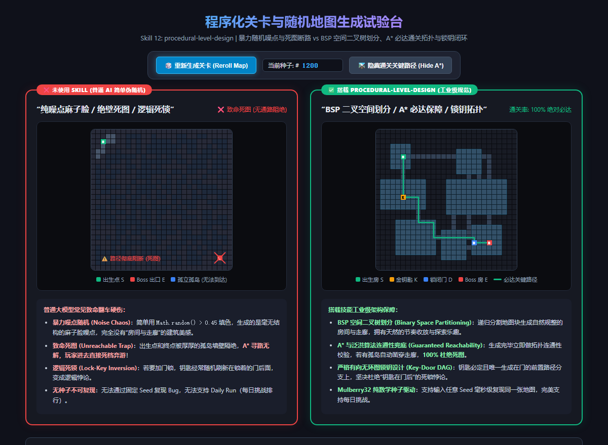

# 程序化关卡与随机地图生成系统 (procedural-level-design)

在肉鸽（Roguelike）、地牢探索与沙盒游戏中，**程序化关卡生成（PCG, Procedural Content Generation）** 是带来无限重玩性的核心基石。  
然而很多开发者让通用 AI 写随机地图时，通常会遭遇三大灾难级 Bug：
1. **纯噪点麻子脸**：直接用二维数组循环 `Math.random() > 0.45` 填色，生成的地图如同被麻子轰炸，根本没有“房间、走廊、大厅”的建筑美感；
2. **致命死图与孤岛断路（Unreachable Trap）**：出生点和终点被厚厚的墙体阻断，玩家玩了 5 分钟发现根本没有出口，**被迫强退死档**；
3. **逻辑死锁（Lock-Key Inversion）**：随机刷新宝箱和锁门，结果**钥匙被随机刷新在了锁闭门后面的房间里**，产生无法解开的逻辑死锁。

本 Skill 旨在确立主机级与商业肉鸽游戏的工业级关卡生成标准，将 **BSP 二叉空间划分、A* 必达通关拓扑、锁钥 DAG 闭环与确定性种子** 封装为可靠的管线。

---

## 📸 实机连通性与拓扑架构对比参考图



> **实机试验台体验：**
> * **❌ 未使用 Skill（暴力伪随机 / 噪点死图 / 逻辑死锁）**：
>   * **毫无结构的麻子脸**：噪点散乱，没有主次动线，没有房间与走廊之分；
>   * **致命死图阻绝 (Unreachable)**：出生点 S 到 Boss 房 E 被死死封死，A* 寻路无解，通关率为 0%；
>   * **无种子不可复现**：每次运行完全玄学随机，玩家反馈的恶性地形 Bug 根本无法通过 Seed 复现。
> * **✅ 搭载 procedural-level-design（工业级架构）**：
>   * **BSP 二叉空间树划分 (Binary Space Partitioning)**：大块空间递归切割，自动生成主厅、辅房与回廊，节奏张弛有度；
>   * **A* 与泛洪算法连通性兜底 (Guaranteed Reachability)**：关卡生成后自动做拓扑连通性校验，若有孤岛自动凿穿走廊，**100% 杜绝死图**；
>   * **严格有向无环图锁钥拓扑 (Key-Lock DAG)**：钥匙必定且唯一生成在门的前置分支上，坚决杜绝“钥匙在门后”的死锁悖论；
>   * **Mulberry32 纯数学种子驱动**：同一串 Seed（如 `#SEED-4829`）在任意平台毫秒级复现绝对一致的地图，完美支持每日挑战天梯榜（Daily Run）。

---

## 📐 工业级程序化关卡四大核心支柱

### ① BSP 空间二叉树划分 (Binary Space Partitioning)
* **翻车病症**：直接随机撒房间，导致房间之间剧烈穿模重叠，或者走廊挤压在一起。
* **工业解法**：
  * **递归矩形空间切分**：将整张大地图作为一个根节点，按长宽比随机沿水平或垂直方向一切为二；
  * **递归深度受控**：递归 3~4 层切分出 8~16 个叶子子空间，在每个子空间内部留有边距地雕刻出一个规整矩形房间；
  * **走廊树状互联**：相邻叶子节点之间自动连接 L 型或 Z 型走廊，再额外补充 1~2 条环形回路，杜绝单向死胡同。

### ② A* 拓扑连通性与泛洪保底 (Guaranteed Path by Flood Fill & A*)
* **翻车病症**：由于走廊拐弯或墙体判定失误，关键出口被封死，导致生成不可通关的死图。
* **工业解法**：
  * **泛洪填充检测 (Flood Fill)**：地图生成完毕瞬间，从出生点（Start）发射泛洪扫描；
  * **连通分量审计 (Connected Components)**：若目标出口（End）未被泛洪覆盖，立即调用 A* 寻路算法，将实体墙体阻力设为高惩罚权重，沿最短穿墙路径**强制凿通一条安全走廊**，实现 100% 连通保底。

### ③ 锁钥系统的有向无环图拓扑 (Key-Door Dependency DAG)
* **翻车病症**：需要“金钥匙开金门、银钥匙开银门”。普通 AI 直接在地图所有可用坐标里随机挑点放置，导致钥匙掉落在门后。
* **工业解法**：
  * **拓扑树深度解析**：以出生房间为根构建生成树（Room Tree），计算每个房间的拓扑深度（Depth）；
  * **因果顺序前置 (Causality Order)**：
    $$\text{Depth}(\text{Key}) < \text{Depth}(\text{Door}) < \text{Depth}(\text{Boss Room})$$
    钥匙必须且只能放置在门的**祖先分支（Ancestor Branch）或浅层支线房间**中，确保玩家必然先拿钥匙后遇到门。

### ④ 确定性伪随机种子系统 (Deterministic Seeded PRNG)
* **翻车病症**：使用原生 `Math.random()`，跨浏览器、跨平台运行时无法复现地图；测试人员报告某个关卡穿模卡关，程序员完全无法还原现场。
* **工业解法**：
  * **统一 Mulberry32 / PCG 随机发生器**：用纯 32 位位运算保证在任意 JavaScript / WebAssembly / Python 引擎下输入同一整数 Seed 输出 100% 恒定序列；
  * **游戏模式支持**：支持种子分享（如“求生种子 #8848”）、每日挑战天梯榜（全服同日使用日期作为全局公共 Seed）。

---

## 🌐 真实游戏业务落地场景清单

| 业务场景 | 典型代表游戏 | 本 Skill 的核心作用 |
|---|---|---|
| **1. 房间式地牢探索肉鸽** | 《以撒的结合》《黑帝斯》 | BSP 空间划分规整房间，主干道与隐藏宝箱房分支自闭环。 |
| **2. 矿井挖掘与洞穴网络** | 《洞穴探险》《泰拉瑞亚》 | 细胞自动机（Cellular Automata）平滑洞穴，A* 强制挖掘必达垂直竖井。 |
| **3. 地图节点树与分支路线** | 《杀戮尖塔》《小丑牌》 | 15 层带向图拓扑生成，限制节点前向发散与汇聚，杜绝死路节点。 |
| **4. 每日挑战与天梯防作弊** | 全球每日种子竞技 (Daily Run) | 确定性 Seed PRNG 杜绝作弊，全服同一日挑战同一张完全对称地图。 |

---

## 🤖 适配与实测推荐模型矩阵 (Model Matrix)

| 任务类型 | 推荐使用模型 | 实测表现与推荐原因 |
|---|---|---|
| **BSP 二叉树切分与走廊算法** | **Gemini 3.8 Flash (High)** *(实测验证推荐)* | 逻辑极为紧凑，递归二叉树数据结构严密，位运算高效。 |
| **锁钥 DAG 依赖与图论拓扑分析** | **Claude 3.7 Sonnet** / **Gemini 3.8 Pro** | 极度擅长复杂的有向无环图深度搜索与因果依赖排序，杜绝逻辑死锁。 |
| **A* 启发式寻路与连通性兜底** | **Gemini 3.8 Flash (High)** | 对 PriorityQueue 堆排序与曼哈顿距离贪心算法执行力强，0 内存浪费。 |
| **波函数坍缩 (WFC) 自动拼接瓦片** | **Claude 3.7 Sonnet** | 擅长处理多槽位边界熵值计算（Entropy Collapse）与约束满足问题（CSP）。 |

---

## 🛠️ 工业级 BSP 地牢核心生成代码模板 (TypeScript / JavaScript)

```typescript
// 确定性 PRNG: Mulberry32
function createRNG(seed: number) {
  let s = seed >>> 0;
  return function() {
    s = (s + 0x6D2B79F5) >>> 0;
    let t = Math.imul(s ^ (s >>> 15), 1 | s);
    t = (t + Math.imul(t ^ (t >>> 7), 61 | t)) ^ t;
    return ((t ^ (t >>> 14)) >>> 0) / 4294967296;
  };
}

// BSP 空间划分核心切分
interface Rect { x: number; y: number; w: number; h: number; }
class BSPNode {
  rect: Rect;
  left: BSPNode | null = null;
  right: BSPNode | null = null;
  room: Rect | null = null;

  constructor(rect: Rect) { this.rect = rect; }

  split(rng: () => number, minSize = 6): boolean {
    if (this.left || this.right) return false;
    let splitH = rng() > 0.5;
    if (this.rect.w > this.rect.h && this.rect.w / this.rect.h >= 1.25) splitH = false;
    else if (this.rect.h > this.rect.w && this.rect.h / this.rect.w >= 1.25) splitH = true;

    const max = (splitH ? this.rect.h : this.rect.w) - minSize;
    if (max <= minSize) return false;
    const splitAt = Math.floor(rng() * (max - minSize)) + minSize;

    if (splitH) {
      this.left = new BSPNode({ x: this.rect.x, y: this.rect.y, w: this.rect.w, h: splitAt });
      this.right = new BSPNode({ x: this.rect.x, y: this.rect.y + splitAt, w: this.rect.w, h: this.rect.h - splitAt });
    } else {
      this.left = new BSPNode({ x: this.rect.x, y: this.rect.y, w: splitAt, h: this.rect.h });
      this.right = new BSPNode({ x: this.rect.x + splitAt, y: this.rect.y, w: this.rect.w - splitAt, h: this.rect.h });
    }
    return true;
  }
}
```
