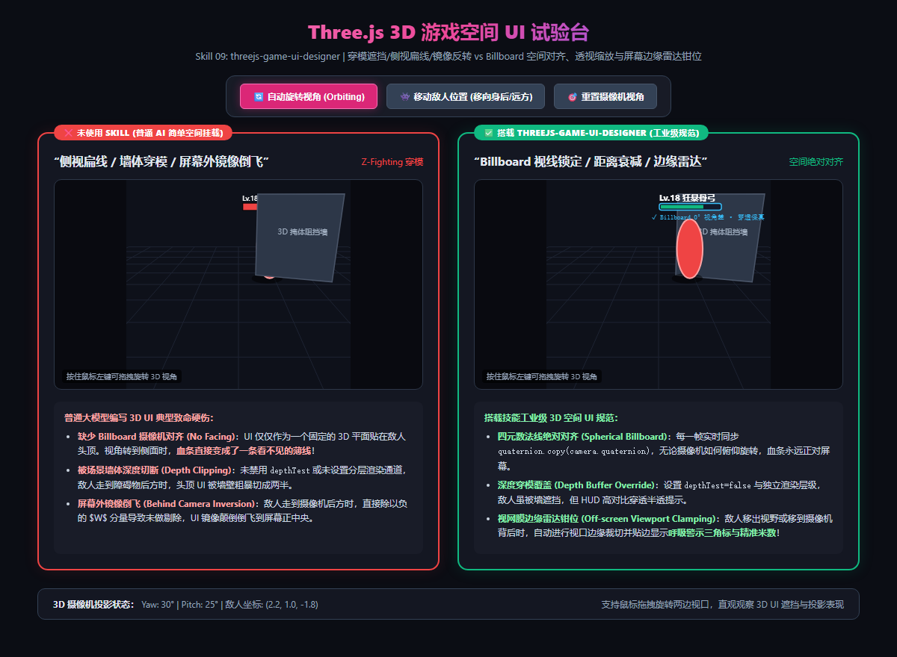

# Three.js 3D 游戏空间 UI 规范 (threejs-game-ui-designer)

在 3D Web 游戏与元宇宙轻量游戏中，**空间 UI（World-Space UI / Diegetic HUD）** 如头顶血条、伤害飘字、任务追踪标记是必不可少的核心组件。  
然而让通用 AI 编写 3D UI 时，通常会产生四大灾难性翻车现象：
1. **侧视变扁线（No Billboard Facing）**：直接把一个 2D Plane 贴在模型头顶。摄像机旋转到侧面时，**血条瞬间压缩成了一条看不见的薄线**；
2. **场景穿模与深度切断（Depth Clipping & Z-Fighting）**：敌人走到石墙或障碍物后方，头顶 UI 被墙面粗暴切成两半，产生剧烈闪烁；
3. **屏幕外镜像倒飞（Behind-Camera Inversion）**：目标跑到玩家身后时，简单的世界坐标转屏幕投影除以负的 $W$ 深度分量，**导致标记倒飞至屏幕正中央**；
4. **DOM 性能雪崩（DOM Reflow Apocalypse）**：同屏 100 个小怪，普通 AI 创建 100 个绝对定位的 HTML `<div>`，引发浏览器每帧重排重绘，帧率暴跌至 15 FPS。

本 Skill 旨在确立主机级与商业 WebGL 游戏的 3D 空间 UI 工业级架构标准。

---

## 📸 实机空间对齐与穿模遮挡对比参考图



> **实机试验台体验：**
> * **❌ 未使用 Skill（简单挂载 / 侧视扁线 / 深度穿模）**：
>   * **侧视视角失真**：UI 仅为一个固定 3D 平面，侧面看时直接失真不可见；
>   * **墙体深度粗暴截断**：未设置 `depthTest=false` 或独立渲染层级，掩体高墙将血条拦腰切断；
>   * **屏幕外镜像反转**：敌人跑到背后时，UI 镜像倒飞在屏幕前乱跳。
> * **✅ 搭载 threejs-game-ui-designer（工业级规范）**：
>   * **四元数空间公告板 (Spherical Billboard)**：每帧实时同步 `quaternion.copy(camera.quaternion)`，无论视角如何旋转，血条始终 100% 正对玩家屏幕；
>   * **深度穿透覆盖 (Depth Buffer Override)**：开启深度覆写与高对比外发光，即使敌人躲在掩体背后，血条与轮廓依然清晰半透可辨；
>   * **视网膜边缘雷达钳位 (Off-screen Viewport Clamping)**：敌人移出视野或移到镜头背后时，自动进行视口边缘裁切并贴边显示**呼吸警示三角标与精准米数**！

---

## 📐 工业级 3D 空间 UI 四大核心支柱

### ① 四元数球形公告板视线锁定 (Spherical Billboard)
* **翻车病症**：使用 `mesh.lookAt(camera.position)` 在摄像机处于正上方俯视时会发生严重的万向节死锁（Gimbal Lock）和局部轴翻转跳变。
* **工业解法**：
  * **直接四元数姿态同步**：
    ```javascript
    uiMesh.quaternion.copy(camera.quaternion);
    ```
    无论是透视投影（Perspective）还是正交投影（Orthographic），公告板永远绝对平行于近剪裁面，彻底杜绝角度偏差；
  * **圆柱形约束（Cylindrical / Y-axis Lock）**：针对地面固定路标，锁定 Y 轴仅随偏航角（Yaw）旋转，呈现符合物理真实感的三维指示牌。

### ② 深度缓冲区穿模覆写 (Depth Buffer Override & Layers)
* **翻车病症**：敌人走入山洞、树木或墙壁背后时，三维深度测试（Depth Test）判定场景物体在前面，导致血条被切断。
* **工业解法**：
  * **材质深度穿透配置**：
    ```javascript
    uiMaterial.depthTest = false;
    uiMaterial.depthWrite = false;
    uiMesh.renderOrder = 9999; // 保证在所有不透明物体之后绘制
    ```
  * **透视 X 光遮挡线（Occlusion Silhouette）**：被掩体遮挡时，UI 自动切换为高对比半透轮廓模式，既提示玩家敌人在掩体后，又保留战术信息。

### ③ 视口边缘雷达钳位与背面点积翻转 (Off-screen Viewport Clamping)
* **翻车病症**：敌人在屏幕外或摄像机后方时，直接使用 `vector.project(camera)` 会得到畸变坐标。如果 $z > 1$（在远平面外）或 $w < 0$（在摄像机后方），未经处理的屏幕坐标会镜像倒置在屏幕正中，严重误导玩家。
* **工业解法**：
  * **相机前向点积检测（Dot Product Check）**：
    $$\text{isBehind} = (\mathbf{P}_{\text{target}} - \mathbf{P}_{\text{cam}}) \cdot \mathbf{V}_{\text{forward}} \le 0$$
    若在背后，将投影向量进行 **$180^\circ$ 极性反转**（$\mathbf{dir} = -\mathbf{dir}$）；
  * **视口安全区边缘钳位（Safe Area Clamping）**：使用视口椭圆/矩形边界将向量钳位在屏幕边缘（如边距 24px），并计算切向角旋转红色警示三角标，同时实时显示距离数字。

### ④ 零 DOM 占用与合批高性能架构 (Zero-DOM Batching)
* **翻车病症**：用 200 个绝对定位的 HTML DOM `div` 做伤害飘字和怪物名字，摄像机快速旋转时，DOM 坐标更新跟不上 WebGL 帧率，文字出现严重**拖影脱节**，引起页面狂热卡顿。
* **工业解法**：
  * **单 Canvas 纹理图集（Single Canvas Texture Atlas）** 或 **三维 Sprite 合批**；
  * **InstancedMesh 批量实例化**：所有头顶血条共用同一个 InstancedMesh，通过顶点属性传递血量比例（HP Ratio）与颜色，**1 个 DrawCall 渲染千人同屏血条**，稳定 60 FPS。

---

## 🌐 真实游戏业务落地场景清单

| 业务场景 | 典型代表游戏 | 本 Skill 的核心作用 |
|---|---|---|
| **1. 3D ARPG / MMO 头顶血条** | 《原神》《魔兽世界》 | 四元数对齐，透视距离衰减防遮挡，深度穿透提示掩体后敌人。 |
| **2. 战术竞技与射击边缘预警** | 《APEX 英雄》《无畏契约》 | 屏幕外手雷/枪声边缘雷达三角标钳位，提供充裕战术反应时间。 |
| **3. 开放大世界 3D 任务地标** | 《赛博朋克 2077》《巫师 3》 | 远景距离米数缩放、近景自动淡出、视口边缘平滑贴合。 |
| **4. Web3D 割草小游戏伤害数字** | 3D 幸存者割草小游戏 | InstancedMesh 批量暴击跳字合批，杜绝 DOM 节点重排雪崩。 |

---

## 🤖 适配与实测推荐模型矩阵 (Model Matrix)

| 任务类型 | 推荐使用模型 | 实测表现与推荐原因 |
|---|---|---|
| **三维矩阵投影与屏幕边缘雷达数学** | **Claude 3.7 Sonnet** / **Gemini 3.8 Pro** | 视锥体几何推导极强，能精准推导点积背面反转与视口安全区椭圆钳位算法。 |
| **Three.js Shader 着色器与 InstancedMesh** | **Gemini 3.8 Flash (High)** *(实测验证推荐)* | 逻辑极为紧凑，能精准编写合批顶点着色器（GLSL）与属性更新管线。 |
| **3D 空间 UI 材质与深度通道配置** | **Gemini 3.8 Flash (High)** | 对 Three.js 的 `depthTest`、`depthWrite`、`renderOrder` 与渲染通道极度熟悉。 |

---

## 🛠️ 工业级 Three.js 空间公告板核心代码模板

```typescript
import * as THREE from 'three';

// 1. 创建高性能空间公告板
export function createWorldSpaceBillboard(texture: THREE.Texture): THREE.Mesh {
  const geometry = new THREE.PlaneGeometry(1.6, 0.4);
  const material = new THREE.MeshBasicMaterial({
    map: texture,
    transparent: true,
    depthTest: false,    // 彻底解决被场景墙体穿模切断
    depthWrite: false,   // 不写入深度缓冲区，防止遮挡后续透明物体
    side: THREE.DoubleSide
  });

  const mesh = new THREE.Mesh(geometry, material);
  mesh.renderOrder = 9999; // 确保在不透明几何体渲染完成后再叠加
  return mesh;
}

// 2. 逐帧渲染对齐与屏幕外雷达计算
export function updateBillboard(
  mesh: THREE.Mesh, 
  targetWorldPos: THREE.Vector3, 
  camera: THREE.Camera, 
  screenWidth: number, 
  screenHeight: number
) {
  // A. 绝对球形公告板视线锁定 (零视角偏差)
  mesh.quaternion.copy(camera.quaternion);

  // B. 透视距离缩放自适应 (近处不糊脸，远处不消失)
  const dist = camera.position.distanceTo(targetWorldPos);
  const scaleFactor = THREE.MathUtils.clamp(dist * 0.15, 0.6, 2.0);
  mesh.scale.set(scaleFactor, scaleFactor, 1.0);
}
```
